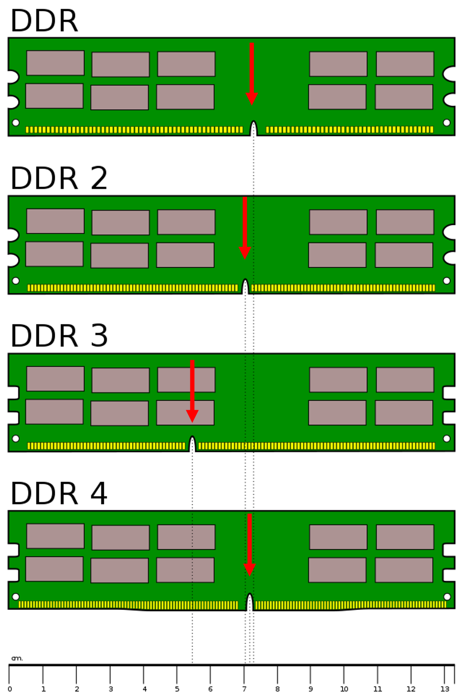
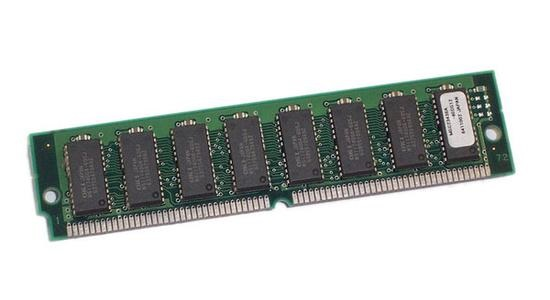
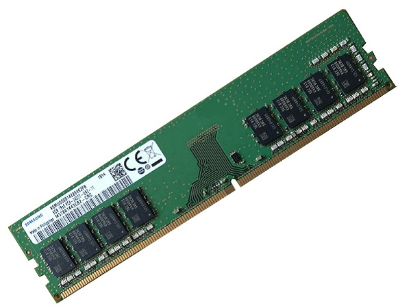
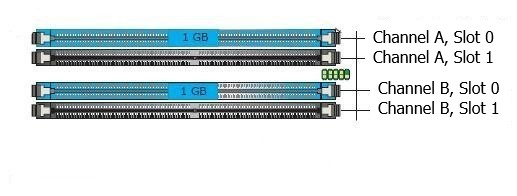
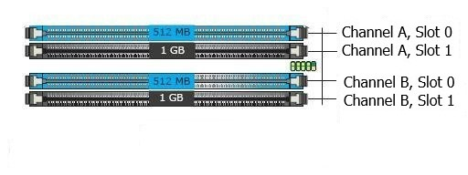

Adapted from the original [slides](./chips_ram_cpu.pdf){target="_blank"} with the help of Claude AI for restructuring. 

## Main Memory (RAM)

- Referred to as **RAM** (Random Access Memory)
- A collection of **integrated circuits** (chips)
- Considered the "**primary**" storage for the CPU
- **Temporary** storage for **data** and **programs** that are being accessed by the CPU
- **Volatile** memory: contents are erased when the computer is switched off (or when power is lost)

### Why use main memory?

Did you ever wonder why games take time to load? That is the time it takes to copy all the files of the game from the storage device (long-term memory) into the working memory of the main memory, which the CPU can access much faster and much more easily.

| Memory | Read/write speed |
|--------|------------------|
| RAM | 12,800 MB/s |
| SSD | 456 MB/s |

More RAM means more capacity to hold and process large programs and files. The maximum amount installed is limited by the **motherboard** and the **operating system**.

### A short history

- Early computers had RAM installed on the motherboard as **individual chips**. These were difficult to install and often became loose.
- Designers then created **memory modules**: special circuit boards on which the memory chips are soldered.
- Modules attach to the motherboard through **memory slots**, so memory can be added or replaced easily.

## Main Memory Features

### Serial Presence Detect (SPD)

How can we get all the specs of the currently installed RAM sticks? Each RAM stick includes an **SPD chip** that stores detailed information about the memory, such as speed, size, manufacturer, and timings. A tool like **CPU-Z** can read the SPD chip, so you can view all the RAM specifications **without physically opening your computer**.


### 1- Data rate 🚀

**SDRAM**

- The original main memory was the **Synchronous Dynamic Random Access Memory (SDRAM)**
- It is **synchronized** with the motherboard speed
- For a 32-bit bus, if the motherboard runs at 100 MHz, the SDRAM speed was also 100 MHz × 32 bits of data sent/received

**DDR SDRAM**

- The first leap in RAM technology was **Double Data Rate** RAM
- For every tick of the motherboard clock, DDR sends/receives **2 bits** of information instead of just 1
- This "doubles" the speed: 2 × 100 MHz × 32 bits

**How can we tell the generations apart?** By the **number of pins** and the **position of the notch**.

{height=300}

| Type | Pins | Notches | Clock speed | Rating by transfer rate | Rating by bandwidth |
|------|-----:|:-------:|------------:|-------------------------|---------------------|
| SDRAM | 168 | 2 | 100 MHz | SD-100 | PC-800 |
| DDR | 184 | 1 | 100 MHz | DDR-200 | PC-1600 |
| DDR2 | 240 | 1 | 100 MHz | DDR2-400 | PC2-3200 |
| DDR3 | 240 | 1 | 100 MHz | DDR3-800 | PC3-6400 |
| DDR4 | 288 | 1 | 100 MHz | DDR4-1600 | PC4-12800 |
| DDR5 | 288 | 1 | 100 MHz | DDR5-3200 | PC5-25600 |

::: {.callout-tip title="Decoding the names"}
The "PC" number is the bandwidth in MB/s: it equals the transfer rate multiplied by 8 bytes (a 64-bit module). For example, DDR4-1600 × 8 = **PC4-12800**.

DDR2 and DDR3 both have 240 pins, so the **notch position** is what keeps you from installing the wrong one.
:::

#### Electrical Pins Configuration ⚡

| | **SIMM** (Single Inline Memory Module) | **DIMM** (Dual Inline Memory Module) |
|---|---|---|
| **Image** | {width=200px} | {width=200px} |
| **Era** | Older type of memory module. Common in early computers (e.g. Pentium I) | Modern type used in most computers today |
| **Contacts** | One set of electrical contacts. Both sides of the stick are connected to the same circuit | Separate electrical contacts on each side of the module |
| **Chips** | A single row of memory chips | Can hold chips on **both sides**, effectively doubling capacity (e.g. 2 GB → 4 GB) |
| **Data path** | 32-bit | **64-bit**, leading to faster performance |

**SO-DIMM** modules are smaller RAM sticks used in **laptops**.

### 2- RAM capacity 📦

- Every stick of RAM has a **capacity** (in GB), which is the amount of information the RAM can store
- The capacity depends on the **size of the chips** (1 Gb, 4 Gb, 16 Gb, etc.)
- The capacity also depends on whether the RAM is **SIMM** or **DIMM**


### 3- RAM channels 📺

- Most motherboards have a limited number of RAM slots, usually **2 or 4**
- RAM is typically sold in **pairs of sticks** to take advantage of **dual-channel** performance
- With **dual-channel** memory architecture, the CPU can access data from **two RAM sticks at the same time** instead of just one. This **doubles the data bandwidth**, making the system faster and more efficient.

Motherboards with four slots usually label them **A1, A2, B1, B2**:

](_assets/ram2.png)


- Slots **A1 and A2** belong to one memory channel
- Slots **B1 and B2** belong to the second channel
- To activate dual channel, install **DIMM** sticks in **matching colored or labeled slots**, e.g. **A2 and B2**
- For the best performance, the RAM sticks in the same channel should be **identical**: same size, speed, and brand if possible

::: {.columns}
::: {.column width=50%}

:::

::: {.column width=50%}

:::
:::

Source of images: [CompuRAM](https://www.compuram.de/blog/en/single-dual-and-multi-channel-memory-modes/)

::: {.callout-warning title="What happens if RAM is installed incorrectly?"}
If you put both sticks in the **same channel** (e.g. A1 and A2), the motherboard treats them as **single-channel** memory.

- The system can only access one stick at a time
- Memory bandwidth is cut in half
- Overall performance drops (especially noticeable in gaming, video editing, or multitasking)


The PC still works, but you won't be using it to its best capacity.
:::

### 4- Memory redundancy and error checking 🚨

Memory errors happen when **data is not stored or retrieved correctly** from the RAM chips. Computers use different types of memory to detect and correct them.

| | **Non-parity** | **Parity** | **ECC** |
|---|---|---|---|
| **Other name** | | True parity | Error checking and correcting |
| **Detects errors?** | No | Yes | Yes (multiple-bit errors) |
| **Corrects errors?** | No | No | Yes (1-bit errors) |
| **How it works** | Nothing extra. If an error occurs, the OS has no way of knowing and data can be corrupted without warning | Extra chips act as parity chips. A memory error is detected and the OS is informed | Detects multiple-bit errors and corrects 1-bit errors automatically |
| **Cost** | Cheapest, works fine for most applications | Middle | Most expensive |

### 5- RAM latency ⏱️

**Latency** is the small **delay** that occurs when the memory controller begins accessing a line of data from RAM. RAM with **lower latency** responds **faster**, while RAM with **higher latency** takes slightly longer to deliver data.

::: {.callout-note title="Latency is a general concept"}
In physics and engineering, latency is a time delay between the cause and the effect of some physical change in a system. It is a consequence of the limited velocity at which any physical interaction can propagate.

Remember from Class 2: CRT monitors have lower latency than LCD/LED monitors because electrons travel faster in a vacuum than through digital circuits.
:::

## Virtual Memory 👻

Every computer can use a portion of its **hard drive** as **temporary RAM** when the system runs out of physical memory. This is called **virtual memory**, and it uses a section of the drive known as a **swap file** or **page file**.

When the computer's real RAM becomes full, the operating system **moves ("swaps")** some data or inactive programs from RAM to the page file. This **frees up space** in RAM for the programs you are currently using.

### Example

Assume your computer has **4 GB of RAM** and several programs installed on your hard drive (**A, B, C, D**).

1. You are running programs **A, B, and C**, and they fill the RAM.
2. You want to run program **D**, but there is **no more free RAM**.
3. A **page file** on your hard drive acts as a temporary storage box. The least-used program (say **B**) is **swapped out** of RAM into the page file.
4. Program **D** can now run in the freed space.
5. Later, if you try to use **B** again, it cannot run from the page file. Another less-used program must swap out, and then **B is swapped back** into RAM.

```{mermaid}
%%| fig-cap: "Virtual memory swapping. Programs move between RAM and the page file on the hard drive."
%%| fig-align: center
flowchart LR
    D["Program D"] -- "2. runs in the freed space" --> RAM
    subgraph RAM["Physical RAM (4 GB)"]
        direction TB
        A["Program A"] ~~~ B["Program B"] ~~~ C["Program C"]
    end
    RAM -- "1. swap out B (least used)" --> PF[("Page file<br/>on hard drive")]
    PF -- "3. swap back in later" --> RAM
    style RAM fill:transparent,stroke:#333
```


::: {.callout-warning title="Disk thrashing"}
Swapping is invisible to the user, but it **takes time** and Windows will slow down. If the page file is accessed too frequently, you may notice the hard drive LED going crazy. This is called **disk thrashing**, and it indicates that the computer would benefit from **more RAM**.
:::

> Exam question: Why is virtual memory not ideal?

::: {.callout-caution title="Expand to see the answer" collapse="true"}
Because the hard drive is much **slower** than RAM. Every swap costs time, so the whole system slows down, and when the page file is accessed **too often** the computer suffers from disk thrashing. The real fix is to install more physical RAM or replacing the software that's using up too much RAM (i.e. get rid of Windows 😈). 

:::


## Key takeaways

::: {.callout-important title="Remember"}
- Install RAM in **matching channel slots** to get dual-channel performance.
- **Virtual memory** extends RAM with the hard drive, but it is much slower.
:::

## Knowledge check


1. A user installs two identical RAM sticks in slots A1 and A2 of a motherboard with four slots. What is the result?

    a. The computer will not start.
    b. The sticks run in dual-channel mode at double speed.
    c. The motherboard treats them as single-channel memory and bandwidth is cut in half.
    d. The sticks automatically become ECC memory.

2. Which type of memory can both detect and correct 1-bit errors automatically?

    a. Non-parity memory
    b. Parity memory
    c. ECC memory
    d. SO-DIMM memory


3. What is "disk thrashing"?

    a. The hard drive failing because of physical damage
    b. The CPU running too hot and slowing down
    c. Excessive swapping between RAM and the page file, which slows the computer down
    d. Deleting the page file to free space


::: {.callout-caution title="Expand to see the answers" collapse="true"}
1. c. Both sticks are in the same channel, so dual channel is not activated. Use A2 and B2 instead.
2. c. ECC memory
3. c.
:::
