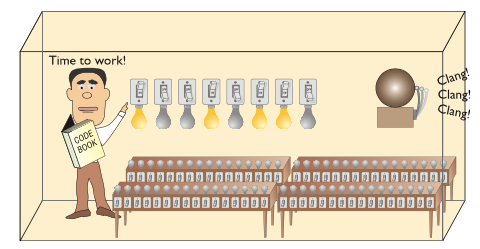
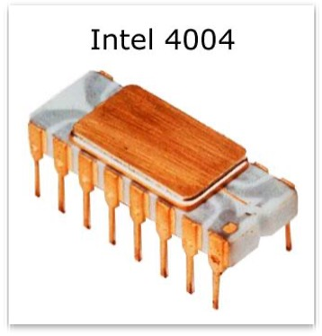
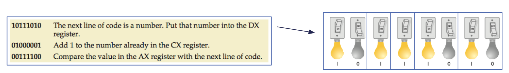

{fig-alt="Sample alt text. To be replaced!"}


## Introduction

Last week one component we learned was the **CPU** (*Central Processing Unit*): A complex collection of electronic
circuits on one or more integrated circuits (chips).

We learned that the CPU is responsible for:

-   *Executing the instructions in a software program.*
-   Communicating with other parts of the computer system

Today we're going to take a deep dive into *how* the CPU carries out those responsibilities.


## Lesson Overview

More detail on CPUs. "Guy in Box" analogy, Clock Speed, Codebook, data buses explained.


::: {.callout-tip icon="false" title="☆Learning Objectives"}

Upon completing this lesson, you should be able to: 

- **Describe** the role of the CPU as the brains of the computer.

- **Use** the guy in the box analogy to explain how a CPU recieves instructions on a schedule, stores temporary values in its registers and communicate through the external data bus.

:::

## Role of a CPU 

The Central Processing Unit (CPU) is the most important element of the computer in terms of computing power.

- The **brains** of the computer
- Responsible for **interpreting and executing** the commands from the software
- Executes a **program**: a sequence of stored instructions
- While the CPU is processing one step of the program, the remaining instructions and the data are stored in a special memory called **cache**

Almost all modern devices include a CPU: desktops, laptops, tablets, smartphones, TVs, TV boxes, vending machines, traffic lights, and smart devices (fridges, washers, light bulbs).

:::{.callout-note collapse="true" title="CPU History"}

### CPU history

The first CPU was the **Intel 4004**, developed at Intel Corp by Ted Hoff and introduced in **1971**: He proposed the idea of using a single universal chip instead of variety of custom chips. 

::: {layout-ncol=2}
{fig-alt=""}

{fig-alt=""}
:::

| Property | Intel 4004 |
|----------|-----------|
| Clock speed | 108 kHz |
| Transistors | 2,300 |
| Performance | 60,000 operations per second (OPS) |
| Memory addressed | 640 bytes |
| Cost at launch | $200 |

> Fun Fact:
> The Intel 4004 was the first commercially available microprocessor, laying the foundation for all modern CPUs.

:::

## CPU Analogy: Guy in a Box 📦

Let's start with an analogy: CPUs are a "Guy-in-a-box". This guy:

- can perform any mathematical function quickly.
- lives in a closed-up box so direct communication is impossible.

Our only way of communicating with this guy is via the __External Data Bus__. This is 16 light bulbs: 8 visible inside the box, and 8 visible outside the box. There is a light switch for each pair (inside-outside) the box which allows us to flip both the inside and outside bulbs and hence send binary messages! 

{fig-alt="Man in a box"}

------------------------------------------------------------------------

::: {.column-margin}
{fig-alt="Sample alt text. To be replaced!"}
:::


### Data bus 💡💡💡
In this analogy this arrangement of light bulbs is called a **data bus:** a method for transporting data from one component to another using electrical circuits.
These "light bulbs": 
-   can be controlled (turned on or off) by us and by the guy-in-the-box
-   are synchronized (bulb 1 for us has the same value as bulb 1 for the guy)
-   we can share messages by setting the light bulbs on off, as long as we: agree on schedule (not changing the lightbulbs at the same time)
-   the meaning (share the same interpretation of lightbulb being on/off)


------------------------------------------------------------------------

### Codebook: Agreeing on meaning 📖
How do we share the same meaning? 

It's important to have common definitions for the meaning of the lightbulbs being on/off to understand messages sent by this method CPUs are designed with a **codebook** (instruction set) that defines the commands that we can give to the guy in the box. This codebook is built into each CPU by its manufacturer and is called "machine code". 

{fig-alt="Sample alt text. To be replaced!"}

::: {.callout-note}
If CPUs only understand machine code (sequence of 1 or 0), how can this C# code be understood by it?

```csharp
Console.WriteLine("Hello World!"); 
```
:::


------------------------------------------------------------------------

### Registers

So far, we can send/receive "messages" from the light bulbs. But, in order to "remember" a message, the guy needs at least a few workstations ( **registers** ) to copy our messages, otherwise the messages will be lost every time the data bus updates.

- **Registers** are places to store a very small amount of data temporarily
- Registers are usually the around the 1-4x the size of the data bus
- We can give the registers names to distinguish them (AX, BX, CX,
DX for example)


{fig-alt="Sample alt text. To be replaced!"}

::: {.callout-note}
Are CPU registers made of the same technology as RAM? 

:::
------------------------------------------------------------------------


### Clock: Agreeing on schedule ⏰

Now we are ready to communicate with the guy in the box. We can send them
the first command by lighting up the bulbs on the data bus.

But how do they know when we have finished setting up the light bulbs?

{fig-alt="Sample alt text. To be replaced!"}


-   We can use a bell activated by a button.
-   A real computer uses a special wire called the clock wire (CLK). The
  CLK wire is turned on and off on a precise and regular schedule.
  This is called a **clock cycle.**
  -   Each time the clock turns on, the state of our lightbulbs is
      shared with the guy in the box
  -   The guy then has until the clock turns off to send a message
      back
  -   The next time the clock turns on, a new message is sent to the
      CPU
-   The time between each clock cycle is the **speed** that a CPU can
  perform a given task
-   The maximum number of clock cycles a CPU can handle in given period
  of time is called the clock speed.

------------------------------------------------------------------------

:::{.callout-tip}

### Sample Guy in a Box Problem

Using the following codebook, ask the "Guy in a box" to calculate 2+3

You must send a series of commandsto the CPU. The CPU will act on each
command and give you an answer.

Your answer should be a **sequence of numbers** you could send to the
guy in the box to get the right answer.

{fig-alt="Sample alt text. To be replaced!"}

------------------------------------------------------------------------

#### Solution


```
10000000  The next line is a number, put it in AX
00000010  The number 2
10010000  The next line is a number, put it in BX
00000011  The number 3
10110000  Add AX to BX and put the result in AX
11000000  Place the value of AX on the external data bus
```

A set of commands such as this is called a program. A program is a series
of command sent to a CPU in a specific order for the CPU to perform
work.

:::

------------------------------------------------------------------------

