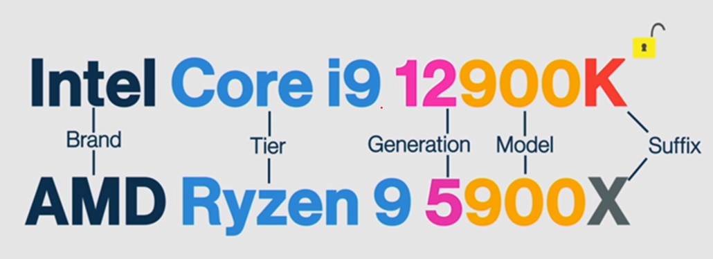
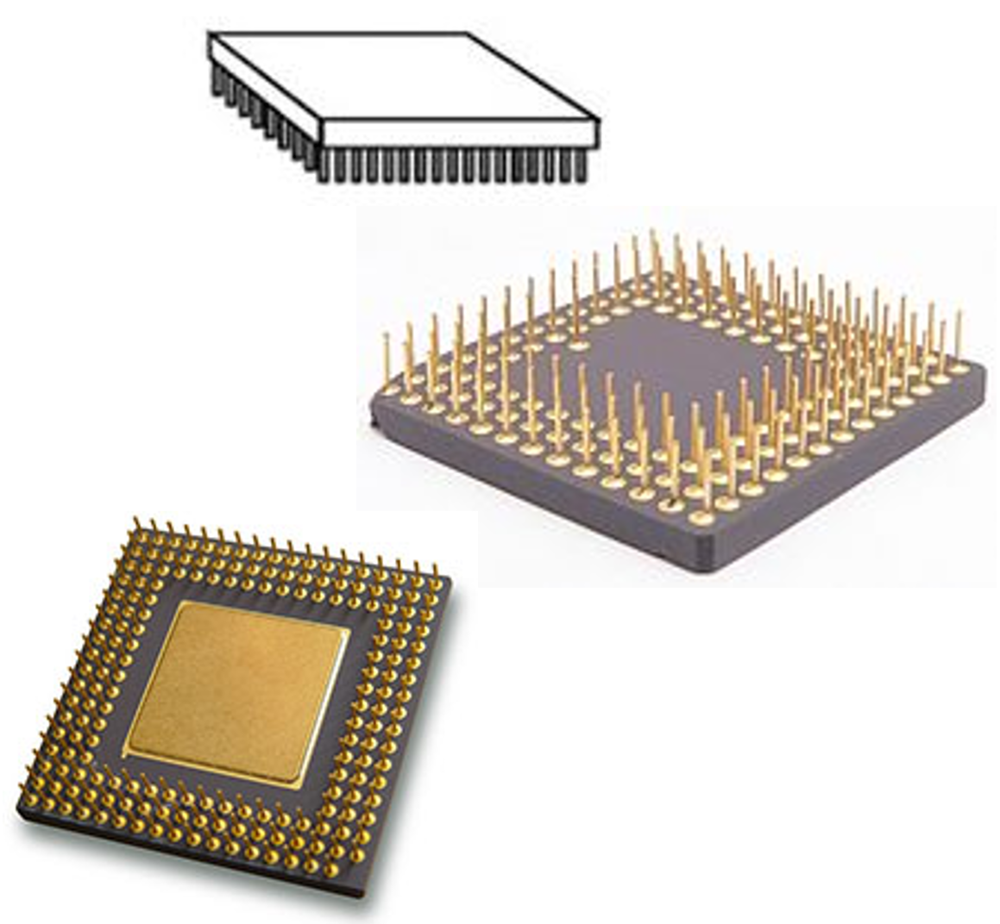
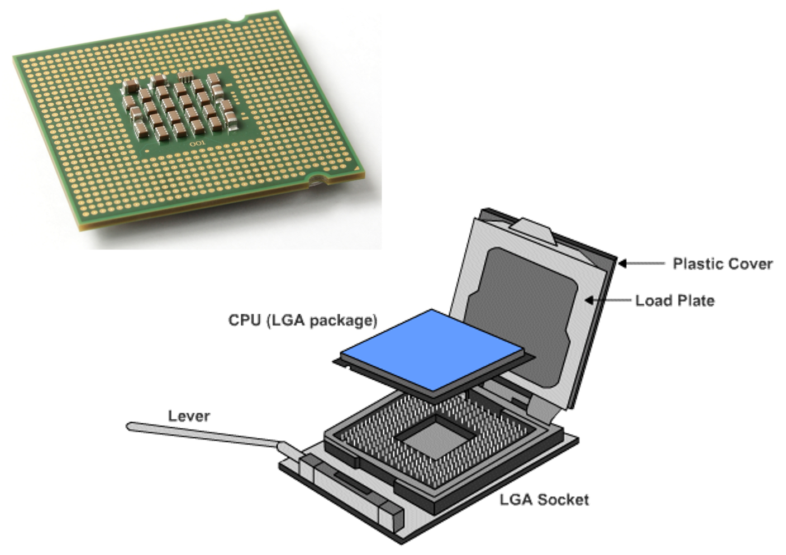
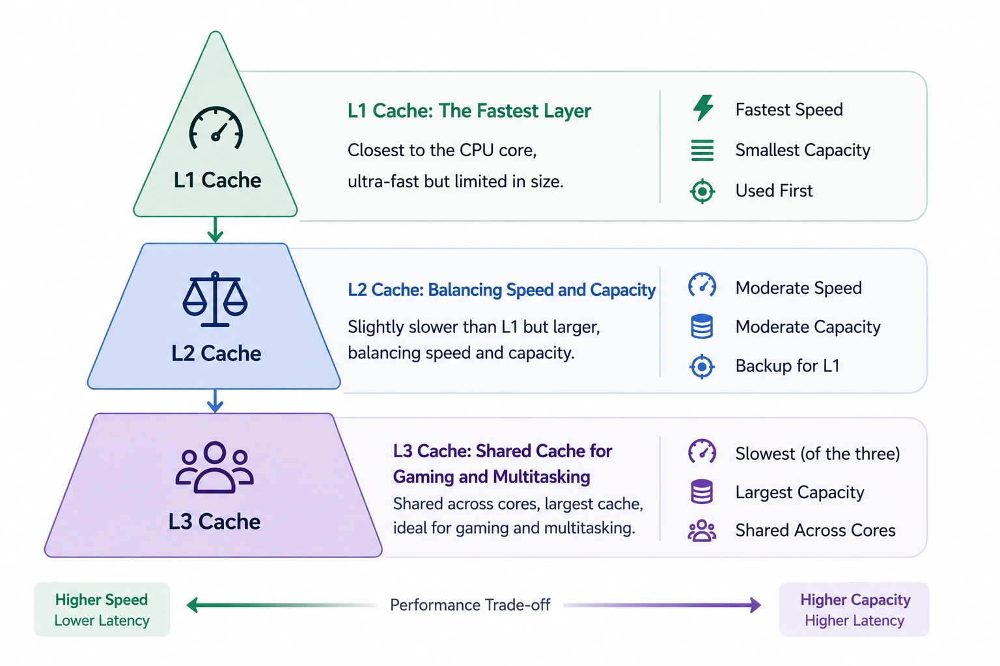
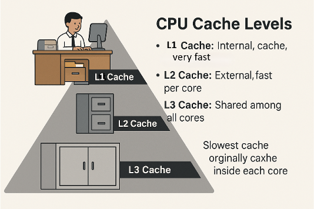
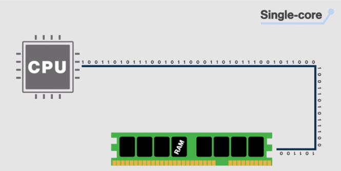
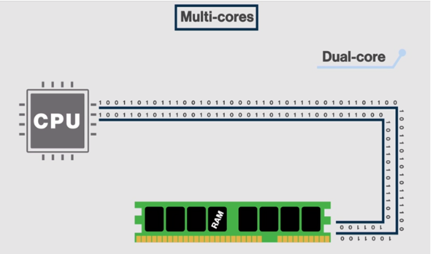
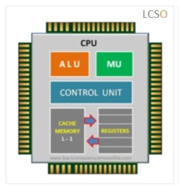

## Introduction
In this lesson, we will breakdown the internal components of a CPU (ALU, MU, CU, Registers), we will explore various properties of a CPU, including the cores and cache memory. Then we will learn about various CPU architectures such as the x86 and the ARM chips. 

::: {.callout-tip icon="false" title="☆Learning Objectives"}

Upon completing this lesson, you should be able to: 

- **Define** the properties of a CPU (clock speed, number of cores, cache).

- **Explain** how the CPU receives intructions and data from RAM.

- **Describe** what is pipelining and its various steps.

- **Describe** the main inner components of the CPU.

- **Distinguish** the control bus, address bus, and data bus.

- **Decode** a CPU model name into brand, tier, generation, model, and suffix.

- **Distinguish** between the different CPU architectures. 

:::

## CPU Properties 📊

The most important properties that define CPU behavior are **speed** and **bus width**: that is, how fast the clock cycle repeats, and how much data per clock cycle the CPU can process.

### 1 - Clock Speed 

We measure CPU **speed** : in cycles per second, e.g. megahertz (MHz) or gigahertz (GHz).

#### Unit of Measurement
__Hertz__, usually written as **Hz**, denote frequency. 1Hz is "one time per second", 10Hz is "ten times per second".
We can use **SI Prefixes** (International System of Unit Prefixes) to compare magnitudes easily.

You will see many of these in computer science over and over again --
get to know them well!

| Unit | Meaning | Definition | Examples |
| :- | :-- | :-- | :--------- |
| Hz | Once per second | 1/s, or 1Hz | 1-2Hz: human heart-rate at rest (1Hz = 60 beats per minute, 2Hz = 120 bpm) 24Hz: framerate of historic cinema 20-60Hz: frequency range for bass notes (C0 = 16.35Hz to C2 = 65.4Hz) 60-144Hz: framerate of most monitors |
| kHz | Thousand times per second | 1000 Hz | 0.1-2kHz: frequency range for midrange notes (A2=0.110kHz, C7=2kHz) 20kHz: maximum frequency audible to human ear 740 kHz: Intel 4004 processor clock speed (1971) |
| MHz | Million times per second | 1000000 Hz | 8MHz: fastest CPU clock speed in the 70s 35MHz: fastest CPU clock speed in the 80s 500-1000MHz: fastest CPU clock speed in the 90s) |
| GHz | Billion times per second | 1000000000 Hz | 2-5GHz: Almost all consumer CPUs in 2024 have base clock speeds in this range 9.117 GHz: fastest CPU clock speed ever recorded (2024) |

: SI Prefixes for Frequencies {.striped .hover}

### 2- CPU Cores
A multi-core SPU means that more than one CPU core is integrated into a single chip, each capable of running parallel processes. This means, in theory, that we multiply the amount of information that can be processes, send and recieved from/to the RAM.

Benefits of Multi-core processors:
- Enhancing the multitasking: multiple jobs done at the same time.
- Improved performance: Faster and smoother performance.
- Energy efficiency: More work can be done with less power.

#### CPU Threads
CPU cores and threads are closely related but not the same. A core is a physical unit within the CPU that executes instructions, while a thread is a virtual sequence of instructions assigned to a core.
Think of cores as workers and threads as the jobs they carry out.  
> When CPU has 16 threads, it simply means it can run 16 threads simultaneously.   

### 3- Bus width

The amount of data processed at a time depends on the "number of lightbulbs" or the **width** of the **data bus**

**Bus width** is measured in bits, e.g. 8-bits, 16-bit, 32-bit, 64-bit, etc.

:::{.callout-note title = "Highway analogy: clock Speed vs bus width "}

-   You can double check that you understand a scientific concept by
    checking what **units of measurement** that concept is measured by:
-   Highway
    -   **Number of lanes:** (a number)
    -   **Speed limit:** (unit distance per time elapsed, e.g. km/h)
-   System bus
    -   **Bus width: ** (a number of bits, eg a 32-bit processor)
    -   **Bus speed: ** (unit information per time elapsed,
        e.g. bits/second)

{fig-alt="Sample alt text. To be replaced!"}

:::

:::{.callout-note icon="false"}

# Question
 How many bits do you need in *bus width* to represent the Guy in the Box and their codebook from the previous problems?

:::
------------------------------------------------------------------------

In actual computers, the CPU receives **instructions** ,**addresses memory** , and **data** on separate buses.

This allows the CPU to send AND receive the following information at the same time:

- **Control Bus**: What command to perform

- **Address Bus**: Where in memory the result should be stored

- **Data Bus**: What data to use to perform the command

{fig-alt="Sample alt text. To be replaced!"}
---

## CPU and RAM interactions 

The CPU is constantly talking to the RAM and the hardware components. At every clock interval, new instructions are sent through the control bus. Here is a simplified design of an 8-bits CPU called the Scott CPU: 

 on Youtube
(excellent video explaination on CPUs)](_assets/understanding-cpus20.png){fig-alt="Sample alt text. To be replaced!"}

Here are a few common instructions written in assembly language: 

| Instruction | Description                                                  |
| ----------- | ------------------------------------------------------------ |
| `LOAD`      | Load this value from RAM                                     |
| `ADD`       | Add these two numbers                                        |
| `STORE`     | Save this value to RAM                                       |
| `COMPARE`   | Compare these two numbers                                    |
| `JUMP IF`   | If a condition is true, jump to this next set of instructions (example : if statement) |
| `JUMP`      | Jump to this next set of instructions (without any conditions - example function call) |
| `IN`        | Read data from the input device (example keyboard)           |
| `OUT`       | Send data to an output device (example printer)              |

Note that assembly code is a "human-readable" form of the binary instructions discussed earlier in the course. 
All this information, the instruction, the location of the hardware devices are translated to binary (machine code)! So when you write a program in C#, Java, Python, etc. You are programming in a high level programming language that will be compiled into machine code by the compiler of this language (or interpreted by the interpreter of this language). 

## Pipelining 🚥

The CPU takes at least four stages (**fetch, decode, execute, write/repeat**) to do something. 

By organizing these steps in a conveyor-belt fashion (called **pipelining**), our "man-in-a-box" becomes "men-in-a-box", which improves efficiency. Each "man-in-a-box" doesn't need to wait until the previous one is done. Several instructions are processed **simultaneously**, each in a different stage, **within the same core**. 

-   **Fetch** : retrieve the instruction, address, and data, write
    them to registers
-   **Decode** : search for instruction code in codebook, verify it
    is a real instruction, and that data/address are valid
-   **Execute** : perform the instruction, update registers with
    results
-   **Write:** write to databus to share results
-   Rather than have each instruction repeat all of these steps, we can organize CPUs further by specializing our "guy in a box" for each stage
-  This is called **pipelining** , and it allows for greater efficiency in CPU programming

{fig-alt="Sample alt text. To be replaced!"}

## CPU Manufacturers 🏭

- **Desktops, laptops, and servers**: **Intel** and **AMD** are the two most popular manufacturers.
- **Mobile devices**: **NVIDIA, Qualcomm, Samsung, and Apple** are major manufacturers of mobile CPUs, used in smartphones, tablets, TV boxes, and other mobile devices.

::: {.callout-note title="Different goals"}
Desktop and server CPUs focus on **high performance**, while mobile CPUs are designed for **power efficiency and compact size**.
:::

- **Brand**: Refers to company who designed the CPU (often Intel or AMD)
- **Tier**: Refers to the ranking of this CPU based on their capacilities and performance. Generally the higher the tier the better the pverall performance of the CPU.
- **Generation**: Tells us how new is this CPU compared to another one. Generally, higher generations within the same tier have improved design.
- **Model**: It's a number that uniquely identify a CPU.
- **Sufix**: Is an added letter which depending on the manufacturer could refer to different properties of the CPU. For example, intel uses "K" to indicate that the CPU is unlocked and can be overclocked. AMD uses X to indicate that this CPU is already slightly overclocked. 

{width=80%}

**Reading a CPU name**

| Part | Intel Core i9 12900**K** | AMD Ryzen 9 5900**X** |
|------|------|------|
| **Brand** | Intel | AMD |
| **Tier** | Core i9 | Ryzen 9 |
| **Generation** | 12 | 5 |
| **Model** | 900 | 900 |
| **Suffix** | K | X |

## Choosing a CPU

When choosing a CPU, there are four main features to look at.

### 1 - Socket: how to connect a CPU

The connection point of the CPU on the motherboard is known as the **CPU socket**. The CPU is connected to the motherboard in one of two ways:

:::: {.columns}
::: {.column width="50%"}
**Pin Grid Array (PGA)**

{.same-height}

- **Where are the pins?** On the **CPU** (underside of the processor)
- **What does the other side have?** The socket includes holes that line up with the CPU pins
:::

::: {.column width="50%"}
**Land Grid Array (LGA)**

{.same-height}

- **Where are the pins?** On the **motherboard** (in the socket)
- **What does the other side have?** The CPU has flat contact pads

:::
::::

::: {.callout-warning title="Be careful with LGA sockets"}
Because the pins are in the socket, they bend easily. Never force a CPU into an LGA socket.
:::

### 2 - Clock speed

CPU clock speed is the **number of cycles per second** the CPU can perform. For example, 3.5 GHz = 3.5 billion cycles per second. A hertz is a unit of **frequency**.

| Unit | Value |
|------|-------|
| 1 Hz | 1 "thing" per second |
| 1 kHz | 1,000 Hz |
| 1 MHz | 1 million Hz |
| 1 GHz | 1 billion Hz |

#### Overclocking and throttling

:::: {.columns}
::: {.column width="50%"}
**Overclocking**

- **What is it?** Making a processor run **faster than its original specification**
- **Effect:** Higher performance, **more heat**
- **Notes:** Not generally recommended: can **increase heat and reduce CPU lifespan**
:::

::: {.column width="50%"}
**Throttling**

- **What is it?** When the processor runs **below its rated speed**
- **Effect:** Lower performance, **less heat and power consumption**
- **Notes:** Helps **conserve power** and **reduce heat**. Commonly used in laptops and mobile devices
:::
::::

> Activity: Bus speed and bus width. A CPU has a 100 MHz, 32-bit bus. How many bytes per second can it process? Now compare it with a second CPU with an 80 MHz, 64-bit bus. Which of the two is faster at sending information?

::: {.callout-tip icon="false" title="Expand to see the answer" collapse="true"}
- First CPU: 100 million cycles/s × 32 bits = 3,200 Mbit/s = **400 MB/s**
- Second CPU: 80 million cycles/s × 64 bits = 5,120 Mbit/s = **640 MB/s**

The second CPU moves more data, even though its clock is slower. The power consumption of the first CPU is bigger because of its higher clock rate.
:::

### 3 - Cores

A **multi-core** CPU has more than one CPU core integrated into a single chip, each capable of running **parallel processes**. Each core has its own ALU, control unit, and registers.

- **Single core**: only one data "lane" connects the CPU to the RAM
- **Dual core**: two lanes of data travel to the RAM
- **Quad core**: four lanes

#### High-end CPUs

CPUs with **32 and even 64 cores** are designed for extreme multitasking, content creation, and heavy computational workloads.

| Property | AMD EPYC 75F3 |
|----------|---------------|
| Clock speed | 2.95 GHz |
| Cores / threads | 32 cores / 64 threads |
| Cache | 256 MB |
| Power consumption | 280 W |
| Cost | CAD $15,699 |

### 4 - Cache

The CPU stores the **most recently used data and instructions** in its **cache**. This **speeds up processing** because the cache is much closer to the ALU, and it increases performance greatly.

**Cache vs RAM**

|  | **CPU cache (SRAM)** | **Main memory (DRAM)** |
|---|---|---|
| **Name** | Static RAM | Dynamic RAM |
| **Built from** | Transistor memory cells | Transistors and capacitors |
| **Refreshing** | Not needed to keep data | Constant power refreshing required |
| **Power use** | Low | Higher |
| **Cost** | Very expensive (≈ $5000/GB) | Good price/capacity balance (≈ $20-90/GB)* |
| **Speed** | Very fast read/write | Fast, but not as fast as SRAM |
| **Volatile?** | Yes (data erased at power off) | Yes (data erased at power off) |
| **Typical amount in a PC** | A few MB | 4-32 GB |

* Price of DDR5 as of Oct 13, 2026.

#### Cache levels

CPU caches are organized into **three levels** to balance speed and size. Each level is a trade-off between **speed** and **capacity** to maximize CPU performance:

L1, L2 and L3 Cache. Image source: <https://www.geekompc.com/what-is-cpu-cache/>

::: {.panel-tabset}

#### L1: internal cache

- Located **inside each CPU core**
- **Fastest** and smallest
- Typical size: 16 KB to 256 KB per core

#### L2: external cache

- Fast, slightly larger than L1
- **Dedicated to each core**
- Typical size: 128 KB to 8 MB per core

#### L3: shared cache

- **Largest and slowest** cache
- Originally mounted on the motherboard, now integrated into the CPU
- **Shared by all CPU cores**
- Typical size: up to 64 MB

:::

::: {.callout-note title="Analogy: the office filing system"}
Imagine the **CPU as a worker** trying to complete tasks.

- **L1 cache = desk drawer.** Holds the papers you are currently working on. Very fast access, small capacity.
- **L2 cache = filing cabinet.** Holds papers you might need soon. Slower than the desk, but bigger.
- **L3 cache = storage room.** Holds papers for everyone in the office. Slowest of the three, but largest.

:::

When the CPU needs data, it searches from the fastest memory to the slowest, and it stops as soon as it finds what it needs:

## CPU Architecture 

### x86 versus x64

:::: {.columns}
::: {.column width="50%"}
**x86 (32-bits)**

{.same-height}

- 32 bits of data can travel at once in between system components
- There are $2^{32}$ possible number with 32-bits
- The CPU can therefore access 2^32 - 4 billion unique memory locations 
- This means it can use up to a maximum of **4Gb of RAM** (in theory)

:::

::: {.column width="50%"}
**x64 (64-bits)**

{.same-height}

- Processes **64 bits** of data at a time
- Can address $2^{64}$ ≈ **18 quintillion** memory locations (that's 4 billion × 4 billion!)
- Far more RAM than any computer has today

:::
::::

Almost all modern hardware and software today use x64 (64-bit) architecture.
64-bits system offer:
🔒 Better security features
🎨 Improved graphics and performance
⚡ Support for larger amounts of memory

💡But! Some older applications still rely on 32-bit (x86) support — so many systems remain backward compatible to run older software.

::::

::: {.callout-tip title="Why does it matter?"}
A 64-bit CPU can run both 32-bit and 64-bit software, but a 32-bit CPU can **only** run 32-bit software. Almost all modern computers are 64-bit.
:::

### CPU components

Each CPU core containts the following **components**:

- **Arithmetic Logic Unit (ALU)**
  - Performs **basic arithmetic** operations: adding, subtracting, multiplication, and division
  - Performs **logical operations**, like comparisons
- **Control Unit (CU)**
  - Manages **all operations** within the processor
  - Instructs the ALU on which arithmetic or logical operation to perform
  - Works in sync with the **system clock**
  - Routes **data internally**, making sure it is fetched and delivered to the correct locations
- **Memory Unit (MU)** 
  -  The MU or MMU (Memory management unit) translate virtual memory into physical memory (more on that later)
- **Registers**: temporary storage for data coming from memory heading to the processor, coming from the processor after processing, or being worked on by the processor
- **L1 Cache** : stores most recently saved data/instructions coming from RAM. Very fast short-term memory. 

As well as data buses for the internal routing of data and instructions: 

- **Internal data bus**: connects the internal components of the processor to the motherboard
- **External data path**: used to fetch data from memory to the processor
- **Address lines**: used to specify the exact location in memory where data can be found

### Other Types of CPUs

### ARM chips

- Simplified CPUs called **Advanced RISC Machine** (ARM), where RISC stands for *Reduced Instruction Set Computing*
- A **simplified instruction set**
- Higher processing speed and reduced workload
- Used in Arduinos and Raspberry Pis
- The Apple M1 chip used in the MacBook Air is an ARM chip

### Accelerated Processing Unit (APU)

- APUs are **CPUs with combined graphics processing capabilities**
- Not as powerful as a dedicated GPU
- A great option for budget gaming
