Adapted from the original [slides](./disk_partitions_file_systems.pdf){target="_blank"} with the help of Claude AI for restructuring.

Before an operating system can store files on a disk, the disk must be **partitioned** and each partition **formatted** with a file system. This page covers how disks are prepared. How files are then organized on them is covered in [File Systems](file-systems.qmd).

::: {.callout-tip icon="false" title="☆Learning Objectives"}

Upon completing this lesson, you should be able to: 

- **Describe** what is disk partitioning and why its used.
- **Differentiate** between the MBR and GPT parition table styles.
- **Describe** what is a logical drive (or Volume) and the various kinds (simple, spanned, striped)
- **Use** hard disk management tools (Disk Management) to create paritions and new volumes.
:::

## Partitioning

**Partitioning** is the process of dividing a storage device (like a hard drive or SSD) into separate sections called **partitions**.

- Each partition acts like an **independent storage unit**, even though they all exist on the same physical device.
- Partitions help the operating system organize data and manage storage more efficiently.
- A hard drive must have **at least one** partition.
- In Windows, each partition is assigned a **drive letter**, such as `C:` or `D:`.

Common reasons for partitioning include:

- Installing multiple operating systems (e.g., Windows and Linux on the same computer)
- Separating system files from user data
- Improving performance or security

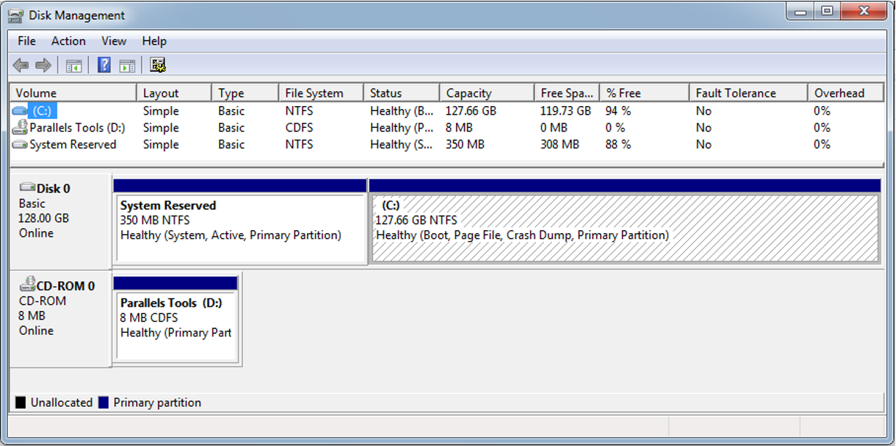{width=600px}

### Advantages of Partitioning

Partitions provide flexibility in organizing data on a hard drive.

**Isolation of OS files**

- Storing the operating system, applications, and user data on the same partition is risky. If the partition's index file becomes corrupted, the system might fail to boot and the data could become inaccessible.
- By keeping the OS and applications separate from personal data (documents, photos, music):
    - Data becomes easier to back up.
    - The OS partition can be formatted or reinstalled without affecting user files.

**Support for multiple operating systems**

As seen earlier, when performing a [dual boot](https://john-abbott-college.github.io/1N6-Notes/topics/operating-systems/operating-system-install.html#dual-boot) installation:

- Users can install different operating systems (e.g., Windows, Linux) on separate partitions on the same drive.
- Each partition acts like an independent drive, making it simple to switch between systems safely.

## Disk Partitions: MBR and GPT

### Windows Disk Settings

When Windows is installed, it automatically prepares the primary disk. When a **new disk** is added, you must:

1. Select a **partitioning style** (MBR or GPT).
2. Select a **disk type** (basic or dynamic).
3. Divide the disk into **partitions** or **volumes**.
4. **Format** the partitions or volumes with a **file system**.

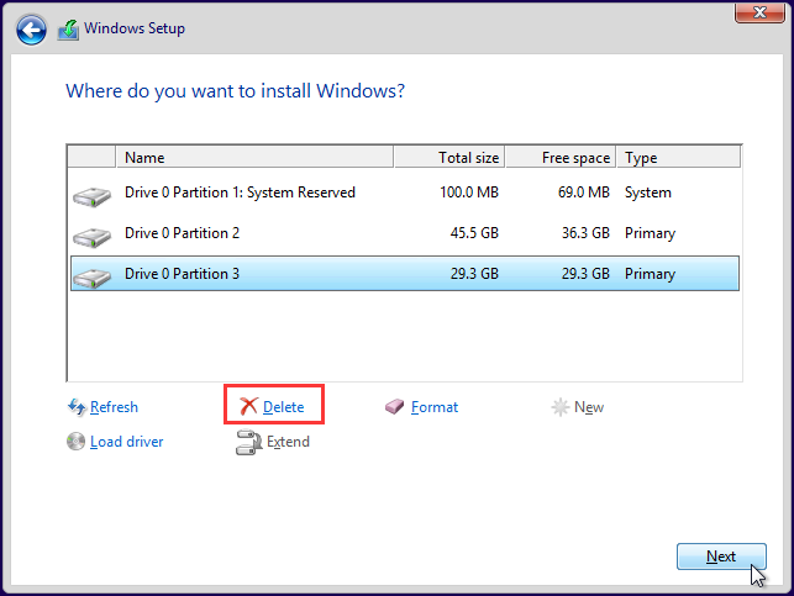{width=500px}

### Selecting a Partition Table Style

- The **partition table** describes the partitions on a disk.
- If the partition table is lost, users can no longer read data from the disk or write new data to it.
- There are two partition table formats:
    1. **Master Boot Record (MBR)**: used with legacy **BIOS**
    2. **GUID Partition Table (GPT)**: used with **UEFI**

### Master Boot Record (MBR)

- The standard partition table format since the **early 1980s**.
- Common partition style for x86- and x64-based computers.
- Maximum: **4 partitions**
- Maximum size: **2 TB per partition**

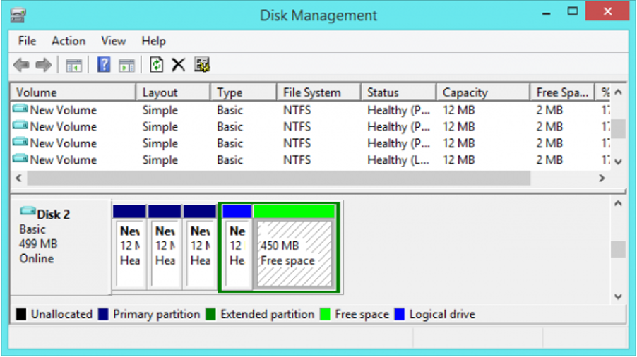{width=500px}

### GUID Partition Table (GPT)

- The **successor** of the MBR partition table format.
- Introduced in the **late '90s**.
- Most operating systems now support GPT.
- Maximum: **128 partitions**
- Maximum size: **18 exabytes per partition**

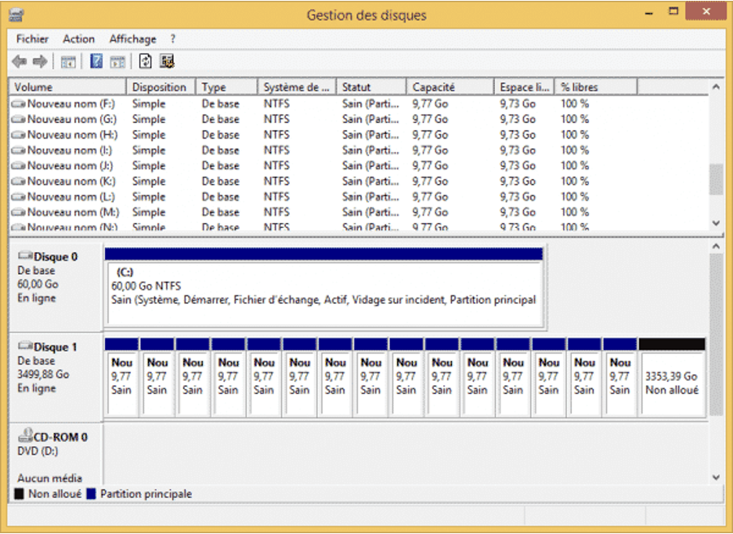{width=500px}

### GPT vs. MBR

| MBR | GPT |
|-----|-----|
| Supports up to **4 primary partitions**, or **3 primary partitions and 1 extended partition** with unlimited logical drives on the extended partition | Supports up to **128 primary partitions** |
| Supports volumes up to **2 TB** | Supports volumes up to **18 exabytes** |
| Hidden (un-partitioned) sectors store data critical to platform operation | Partitions store data critical to platform operation |

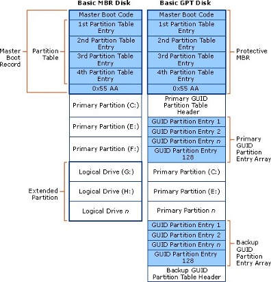{width=400px}

### CMD Command: DISKPART

`diskpart` is a command-line tool for managing disks. The `list disk` command shows every disk, its size, and whether it is dynamic (`Dyn`) or uses GPT (`Gpt`).

{width=600px}

## Disk Types

| Basic Disk | Dynamic Disk |
|------------|--------------|
| Compatible with older operating systems | Supported by Windows 2000 and later |
| Consists of **primary** and **extended partitions** | Does not use traditional partitioning |
| Supports up to 4 partitions (per hard drive) | Allows disk and volume management **without restarting** the computer |
| | Can **combine two or more physical disks** into one dynamic disk |
| | Divided into **volumes** (not partitions) |

### Partitions with MBR and GPT

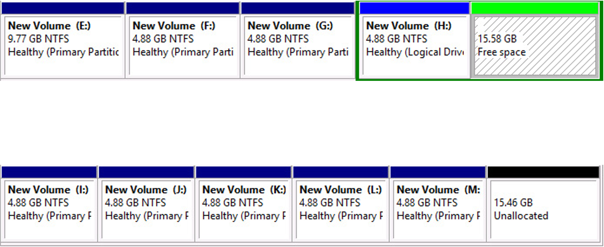

### Primary vs. Extended Partitions

| Primary | Extended |
|---------|----------|
| Looks like a physically separate disk. **Can host an operating system.** | **Cannot host** an operating system |
| Can be marked as an **active** (bootable) partition | Cannot be marked as an active partition |
| On a basic MBR disk, you can create up to 4 primary partitions, or 3 primary partitions and 1 extended partition | A basic MBR disk can contain only **1 extended partition**, but unlimited **logical drives** |
| You format each primary partition and assign it a unique drive letter | You do not format the extended partition itself, but the logical drives it contains. Each logical drive gets a unique drive letter |

## Volume Types

Dynamic disks are divided into volumes. There are five volume types:

- Simple volume
- Spanned volume
- Striped volume
- Mirrored volume
- RAID-5 volume

We will discuss all those in details when Servers will be discussed. 

### Simple Volume

- A portion of a disk, or an entire disk, that is set up as a dynamic disk.
- Can be extended onto multiple sections of the **same disk**.
- Can be extended to multiple disks to become part of a spanned or striped volume.

## Spanned Volume
- Combines space from multiple dynamic disks into a single large volume.
- As new disks are added, the spanned volume can be extended to include them.
- One disk is filled before moving on to the space of the next disk.
- Does not increase performance.
- Does not provide fault tolerance.

## Striped Volume (RAID 0)
- Combines space from multiple dynamic disks into a single large volume.
- Cannot be extended after it is created.
- Data is written equally across all disks.
- Increases disk performance.
- No fault tolerance.

## RAID-5 Volume
- Requires a minimum of 3 disk drives.
- Parity information is distributed across each disk.
- If one disk fails, the information on that disk can be reconstructed.
- Improved read performance because of disk striping.
- Slower write performance because of the parity calculations.

## Formatting

After partitioning a disk, **each partition must be formatted** before it can be used.

**Formatting** is the process of preparing a storage device, such as a hard disk or partition, for use by **creating a file system** and establishing a **root directory**. It organizes the partition so that the operating system can efficiently store and manage files and folders.

Key points:

- Every partition must be formatted before it can hold files.
- Formatting sets up the structure that allows the OS to read from and write to the storage device.
- Formatting prepares the disk **logically**, not physically, for everyday data storage.
- The file system created during formatting determines compatibility with the operating system and device type. See [Windows File Systems](file-systems.qmd#windows-file-systems) for NTFS vs. FAT32.

## Disk Imaging and Cloning

### Disk Image

A disk image is a complete copy of a computer disk, stored as **one large compressed file**. It includes:

- System files
- Device drivers
- Installed applications
- User profiles and data

A disk image can be deployed on a new disk if:

- The old disk malfunctions.
- You upgrade to a new disk (larger or faster).

Once the image is deployed, the new disk can be placed in the computer and you can carry on working with all your applications and data. However, you **lose any data and changes made after the image was created**.

::: {.callout-note title="Example"}
You want to replace your disk with a larger one. You create a disk image and save it to an external drive. Afterwards, you remember you need to edit some photos, so you install Photoshop, download the photos, and save them to the disk. While you are working, the system disk fails because of a hardware issue. You install a new disk and deploy the image on it. Photoshop and the downloaded photos **will not be there**, because they were added after the image was created.
:::

### Disk Cloning

Disk cloning copies the contents of a computer disk to another disk (or to an image file). A clone includes:

- Hidden files
- Files that are currently in use
- Deleted files (how is that possible? See [Deleting Files](file-systems.qmd#deleting-files).)

In cloning, the hardware must be **identical**. What happens if the disks are not the same size?

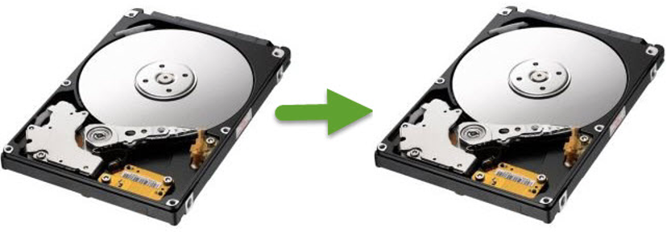{width=400px}

### Imaging vs. Cloning

Both methods create an **exact replica** of your hard drive, including files, the master boot record, applications and the OS. Both are a **full system backup**.

- **Cloning**: an exact copy of everything on the disk, **bit by bit**.
- **Imaging**: creates **one single compressed file** containing everything.

If your hard drive dies:

- You can simply **swap** it with a clone (disk).
- An image must first be **deployed** on a new disk before you can go back to work.

# OS Maintenance 
## Preventative Maintenance
- Disk cleanup
- Disk defragmentation 
- Hard drive error checking 
- Updates to OS (e.g. service packs) and applications.
- Updates to antivirus and other protective software.

## Disk Cleanup
- Removes unneeded files e.g.
- - Temporary internet files
- - Files downloaded to install programs
- - Files in the recycle bin
- - Log files
- - Temporary files
- - Thumbnails
- - Admin can also clean up system files.

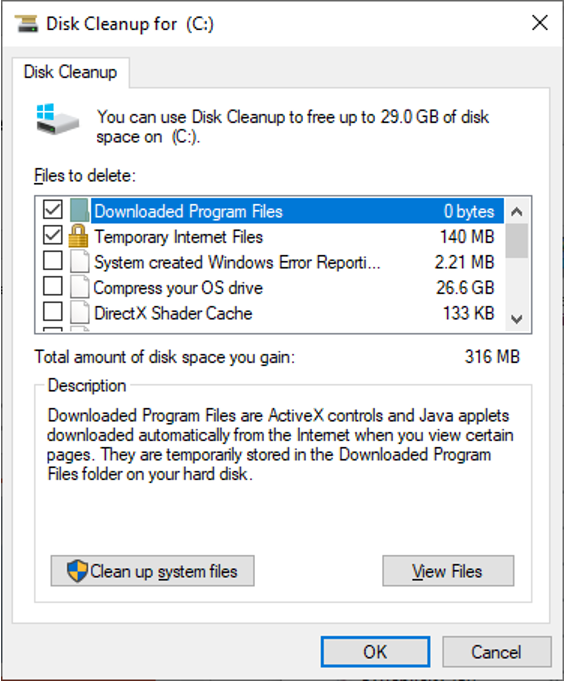{width=400px}

## Disk Defragmentation 

If a storage device is [fragmented](https://john-abbott-college.github.io/1N6-Notes/topics/operating-systems/file-systems.html#fragmentation), it can slow down your computer.
A disk can become fragmented very quickly if it is used heavily and data is written to it often. Disk defragmenter typically runs  on a schedule but you can analyze and defrag manually.

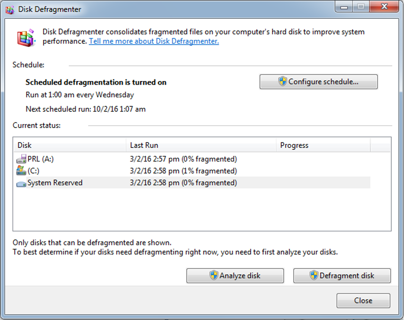{width=400px}

On older versions of Windows, the defragmenter came with a visualization tool..

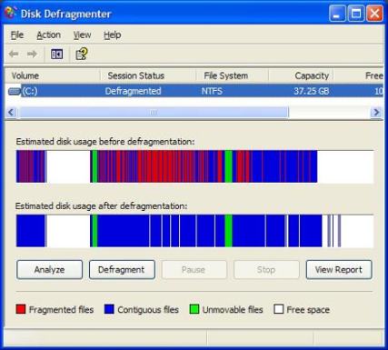{width=400px}

## Hard Drive Error Checking

The Disk Check tool in Windows can find and repair file system errors on:
Local hard drives.
Removable media such as USB flash drives or memory cards.

On Windows 11: 

1. Open File Explorer:

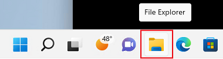{width=400px}

2. Right-click the drive 

3. Select Properties

4. Select the Tools tab > Check:

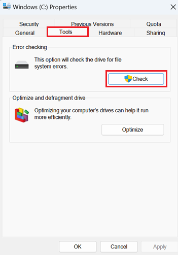