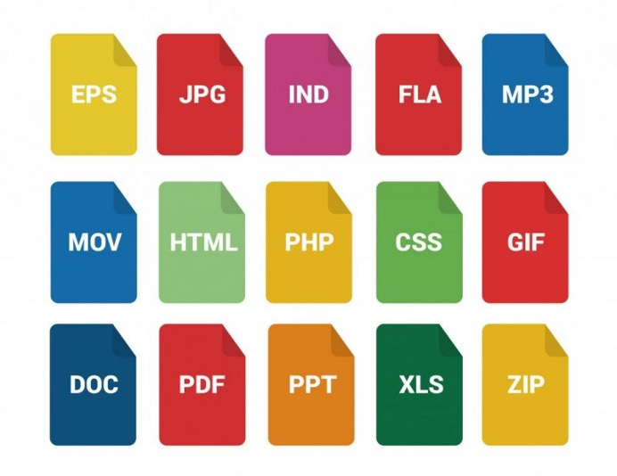
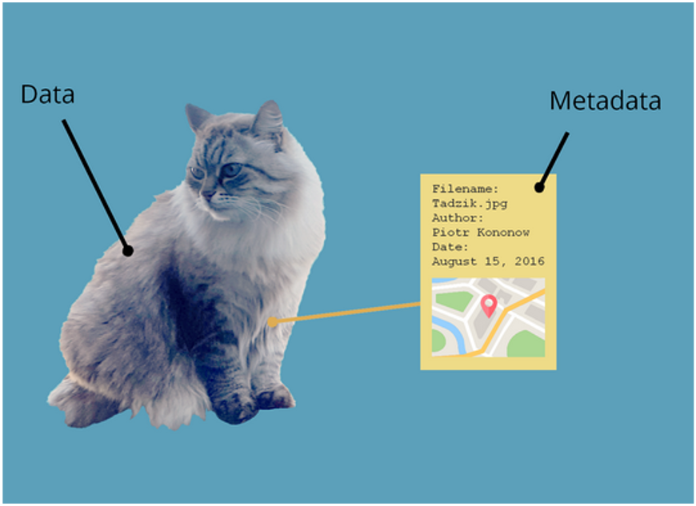
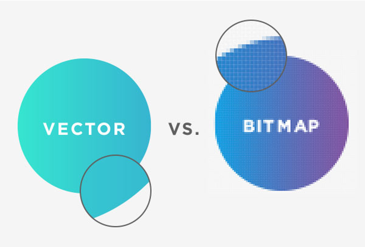
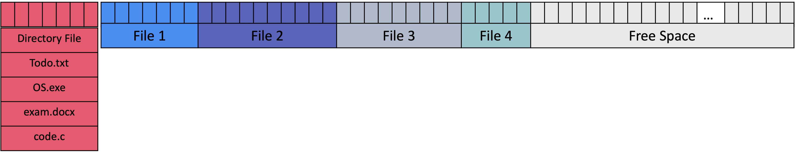
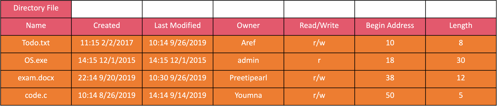
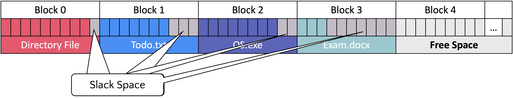
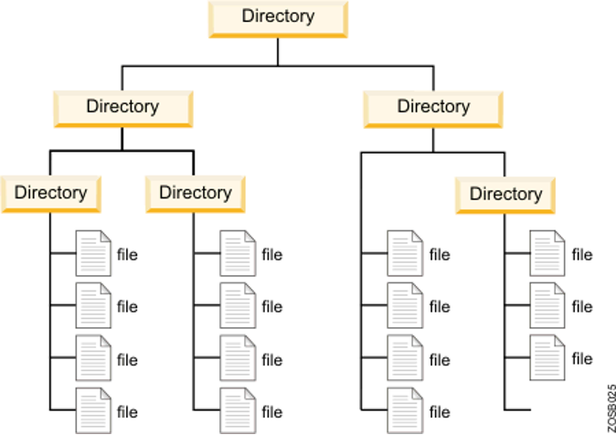
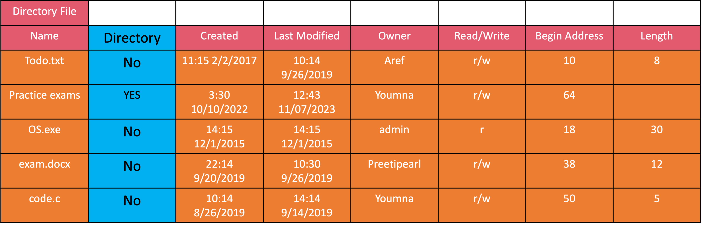

Adapted from the original [slides](./disk_partitions_file_systems.pdf){target="_blank"} with the help of Claude AI for restructuring.

This page covers how files are organized once a disk has been partitioned and formatted. For partition styles, disk types and volumes, see [Disk Partitions](disk-partitions.qmd).

# Introduction
> This section was made by Sandy Bultena for __Programming in Science__ (Fall 2024). All credits and thanks to her. 

Computers only think in terms of 1s and 0s (binary). Every bit of information on your computer is coded in binary and the your computer will translate one set of of 1s and 0s to another when displaying information on your screen.

{width=80%}

::: {.callout-tip icon="false" title="☆Learning Objectives"}

Upon completing this lesson, you should be able to: 

- **Describe** what is a file type and its file extension.
- **Recognize** common file formats.
- **Describe** what is a file metadata, its role and its location on a drive.
- **Describe** what is a directory file and its role.
- **Describe** the process of fragmentation and defragmentation.
- **Describe** the process of deleting a file. 
- **Predict** which blocks a set of files will occupy on a storage diagram, given the block size and the location of the directory file.

:::

## What's a file?

On a computer, you probably have pictures, word documents, saved video games, applications, code, plus a whole lot more. It would be very difficult if every time you opened Word, every document that you ever wrote was all smushed together.

So, to make your life easier, your computer organizes data into discrete elements, called files. Each file has the data for one thing only, for example, one picture, one Word Document, one application, etc.

In the old days, files used to be a document that was printed on paper. Today, most people refer to files as a document of some kind (picture, code, Word, etc) that is stored on your computer.

## Computer file-system
To make the transition from storing files on paper, in paper folders, in filing cabinets, to storing files on computers easier, the powers that be decided to use the same names, i.e. files and folders.

> NOTE: before computers were used everywhere, folders used to be called directories and the words mean EXACTLY the same thing, so if your teachers forget, and says "directory", remember that they actually mean folder.

So, in a folder you can have files and other folders.

Since folders are not longer physical things, we need a way to envision them.

In short, folders (or directories) are organized into a tree format.

```
My Documents
     | --- English
     |   |-> Assignment 1.docx
     |   |-> Assignment 2.docx
     | --- Programming
     |   | --- Assignment 1
     |   |   |-> Instructions.pdf
     |   |   |-> code.py
     |   |   |-> output.txt
     |   |   |--- Assignment 2
     |   |   |   | -> Instructions.pdf
     |   |   |   | -> code.py
     |   |   |   | -> output.csv
```

## What is a File Extension?
The file extension is defined as the last bit of a file name that follows the last dot (.) Kinda of like a last name. It determines the **file format** of each file.

Example: code.py has a file extension .py. A word document typically has the extension .docx, so the filename is typically assignment 1.docx.

###  Why don’t I see them in File Explorer?
The developers at Microsoft have designed File Explorer to be easy(?) for non-programmers to use, and so by default they hide the file extension.

But, you are now a programmer, and you absolutely need to know what the file extensions are…

Please follow the instructions in: MS Windows Support - Show file extensions

### Why do we use File Extensions?
The file extensions give a hint to the operating system (Windows/Linux/Mac) as to what type of data is in the file. So if the extension is .png then the operating system knows that it is a picture, and if you double click the filename in File Explorer, it will call the appropriate program that can show you the picture.

Likewise if the file extension is .docx, double clicking the file in File Explorer will open Microsoft Office which in turn will read the file and display it to you.

## Common file formats

There are many types of files: text files, music files, photos and videos.A **file format** defines how data is organized and stored inside a file. When saving a file, the OS or application follows a specific standard format to structure the data correctly.

- Examples of standard file formats: **JPEG**, **MP4** and **DOCX**.
- Programmers can also create their own custom formats to store data in a unique way. However, a **non-standard format** can only be read by the applications that created it.

{width=350px}

# Text Files

- Text files are commonly known as **.TXT** files.
- They are often created and opened using programs like Notepad or TextEdit.
- Even though they display readable text, the data is still stored in **binary** (0s and 1s) inside the computer.
- Text files are useful for saving simple information, such as notes, configuration data, or source code.
- They do not include special formatting (like bold, color, or images), only text characters.

Here is how the text `Hello World` is stored in binary, using ASCII:

| ASCII | H | e | l | l | o | (space) | W | o | r | l | d |
|-------|---|---|---|---|---|---------|---|---|---|---|---|
| Binary | 01001000 | 01100101 | 01101100 | 01101100 | 01101111 | 00100000 | 01010111 | 01101111 | 01110010 | 01101100 | 01100100 |

## Text Files vs. Formatted Text Files

| Feature | Text File (.TXT) | Formatted Text File (.DOCX, .PDF) |
|---------|------------------|-----------------------------------|
| Content type | Plain text only | Text with formatting, images, and layout |
| Editable with | Notepad, TextEdit | Word processors (e.g., MS Word) |
| File size | Small | Larger (due to extra formatting data) |
| Readability | Human-readable | May require specific software |
| Use case | Notes, code, configuration | Reports, documents, presentations |

# File Metadata

Some file formats, like videos, images, or documents, need more structure than simple text files. To read these files correctly, computers must store **extra information** about the file. This extra information is called **metadata**, which means "**data about data**."

File metadata describes important details about the file's contents, such as:

- File type and format
- File size
- Creation or modification date
- Author or source information

Metadata helps the operating system or application understand how to open, display, or process the file. It is usually stored at the **beginning** of the file, before the actual data, in a section called the **file header**.

{width=450px}

## Example: Bitmap Photo (BMP)

A BMP file starts with the letters `BM`, followed by metadata fields such as the file size, offset, header size, photo width and height, planes and color depth. The actual pixel data comes after the metadata.

{target="_blank"}](_assets/file_systems/img9.png)

## Files and File Formats

Under the hood, all files are the same: **long lists of numbers**, stored as binary, on a storage device. Every file is made up of two main parts:

- **Metadata**: information about the file (e.g., name, size, type, and structure).
- **Actual data**: the real content inside the file (e.g., text, image pixels, or audio signals).

The **file format** determines how the data and metadata are organized. Without the correct file format, a program wouldn't know how to read or display the data properly. In other words, file formats are the key that unlocks the meaning of the binary data inside a file.

{width=400px}

# File Systems

A **file system** is the method an operating system uses to **store**, **organize**, and **manage** files on a storage device.

## Saving Files to Storage Devices

When you save a file, the file system decides **where** and **how** the data is stored on the device. It keeps track of:

- File names and locations
- File size and type
- Date created or modified
- Access permissions (who can read or edit the file)

The file system acts like a **digital librarian**, keeping everything in order so files can easily be found and opened later. Without a file system, data on a storage device would be unorganized, making it impossible to locate or retrieve files.

Common file systems include:

- **NTFS**: used by Windows
- **APFS**: used by macOS
- **EXT4**: used by Linux

## How the File System Manages Files and Directories

- Organizes data into files with names, types, and sizes.
- Uses **directories** (folders) to group and arrange files.
- Creates a **hierarchical structure** starting from the **root directory**.
- Tracks each file's location using allocation tables or indexes (e.g., FAT, inodes).
- Stores metadata: creation date, permissions, size, etc.
- Controls access with file permissions (read, write, execute).
- Supports operations like create, open, move, rename, and delete.

## Windows File Systems

- **NTFS** (New Technology File System)
    - Supports partition sizes up to **16 exabytes** (in theory).
    - More security features and extended attributes than FAT.
- **FAT32** (File Allocation Table 32-bit)
    - Supports partition sizes up to **2 terabytes**.
    - Limits file size to **4 GB**.
    - Used by Windows XP and older versions.

## How File Systems Work

### Storage in Early Computers

- In the early days of computing, when systems could perform only one task at a time, storage was managed as **one continuous file**.
- Data was written **sequentially**, starting from the beginning of the storage medium.
- As the computer produced output, data filled the storage in order, until the entire capacity was used.
- There was no concept of folders or file systems: all data existed as a **single stream** of information.


### A Simple File System

As computing power and storage capacity grew, more than one file needed to be stored at the same time. How would we store multiple files?

- The simplest solution is to store files **back-to-back**.
- But how would the computer know where each file **begins and ends**?
- Storage devices have no idea what a file is. They are just a mechanism for storing data.

### Solution: The Directory File

A **directory file** is a special file added to the storage so the OS can find the files on the disk.

- It is kept at **location zero** (before any data).
- It includes the **names of all the files** in storage (e.g., the file `Todo.txt` has the filename `Todo` and the extension `txt`).



The directory file also stores **metadata** about each file, including where it begins and how long it is:



If a file is added, removed, or renamed, the information in the directory file must be **updated**.

## Main Issue with the Simple File System

Stacking files back-to-back is **not** a proper solution for storing data:

- Files **grow** in size as more data is added to them.
- A growing file will **overwrite** the data of the file next to it.
- Example: if data is added to `Todo.txt`, there is no room for it without overwriting part of `OS.exe`.

## Modern File Systems: Blocks

To avoid overwriting the data of other files, modern file systems:

- Store data in **fixed-size blocks**.
- Leave extra space for a file to grow. This extra space is called **slack space**.
- Use the same block size for all file data, which simplifies management.
- Let a file occupy **more than one block** if needed or as it grows.



The directory file keeps track of **each block** occupied by a file:

| Name | Created | Last Modified | Owner | Read/Write | Blocks |
|------|---------|---------------|-------|------------|--------|
| Todo.txt | 11:15 2/2/2017 | 10:14 9/26/2019 | Michael | r/w | 1 |
| OS.exe | 14:15 12/1/2015 | 14:15 12/1/2015 | admin | r | 2, 9, 5 |
| exam.docx | 22:14 9/20/2019 | 10:30 9/26/2019 | Gabriel | r/w | 3 |
| code.c | 10:14 8/26/2021 | 14:14 9/14/2021 | Helen | r/w | 10 |

Using blocks:

- Allows files to be broken into chunks and stored across many blocks.
- Lets files easily grow or shrink in size:
    - **Grow** → needs more space → a new free block is allocated.
    - **Shrink** → space is no longer needed → the reserved block is deallocated.
- A file can grow to occupy as many blocks as needed.
- Blocks might not be located next to each other, or even in order.

## Fragmentation

A file being broken up across storage is called **fragmentation**. It is the result of files being created, deleted and modified.

- Fragmentation occurs when a file is split into multiple parts and stored in different locations on the storage device, instead of in one continuous block.
- This increases the time needed to access the file, especially on **hard disk drives (HDDs)**, which rely on moving mechanical parts to read data.
- Large files spread across many scattered blocks take longer to read, because the disk head must move back and forth to gather all the pieces.

## Defragmentation

**Defragmentation** is the process of reorganizing data on a storage device so that each file's blocks are stored **together and in the correct order**. This reduces fragmentation, allowing the operating system to access files more quickly and improving overall disk performance.

Modern file systems are designed to minimize the need for defragmentation:

- Larger block sizes create more slack space, reducing the need to allocate additional blocks.
- **Scatter allocation**: files may be spread across the disk to leave enough space for growth.
- Defragmentation can run in the background without interrupting normal use.

Impact of newer storage hardware:

- Modern HDDs are faster and can read fragmented data more efficiently thanks to parallelization.
- **SSDs do not benefit from defragmentation**, because their data is not physically separated in a meaningful way. Running defragmentation on an SSD **reduces its lifespan** without improving performance, so it is **not recommended**.

## Flat vs. Hierarchical File Systems

| Flat File System | Hierarchical File System |
|------------------|--------------------------|
| All data is saved on **one level** | Related files can be stored in **directories** (also known as **folders**) |
| Similar to the examples above | Directories can be **nested** inside other directories |
| No notion of directories | Extra metadata is needed to track what is a file and what is a directory |
| | The top directory is known as the **root directory** |

{width=450px}

To support directories inside directories, the directory file needs an extra column that marks which entries are directories:



{width=450px}

## Activities

### Manipulate Files Using CMD

1. Open the command prompt (`cmd`).
2. Navigate to the desktop.
3. Create a directory called `meals`.
4. Create a file called `breakfast`.
5. Write the line `coffee` inside the file.
6. Write the line `toasts`.
7. Open the file.

Some useful commands:

```bat
cd desktop
mkdir meals
echo coffee > breakfast.txt
type breakfast.txt
```

### View Raw Data in Hexadecimal

In PowerShell, you can view the raw bytes of a file in hexadecimal:

```powershell
format-hex filename
```

# Deleting Files

## How Does Deleting a File Work?

- The user experience varies across operating systems, but the underlying behavior is largely the same.
- Most operating systems provide a **Recycle Bin** (or **Trash**) directory. When you use the default delete command, the file is **moved** to this directory rather than removed immediately.
- The Recycle Bin works like any other folder: files can be recovered simply by moving them out of the bin.

## Deleting a File Permanently

To remove a file permanently, it must be deleted **bypassing the Recycle Bin**, either with a special delete command (e.g., **Shift + Delete** on Windows) or with command-line tools that do not move the file to the bin.

You might think that clicking "Empty Recycle Bin" actually deletes your files. But how does it really work? Does it move the files to a "Recycle Bin 2"? Not quite. To understand, remember how data is stored: in **blocks** on the storage device.

**Answer:** the OS **removes the file from its directory file**. The operating system no longer "knows" about the file (there is no way to reference it), and its blocks are considered **free space**.

## Is the Data Really Gone?

- Data deleted this way **can still be recovered**!
- Recovery can be very difficult: optimizing data recovery programs is an open field of research.
- In principle, you can view all the bits in free space and recover the data directly.
- The problem: the longer the bits stay in free space, the more likely they will be **overwritten** by a new file or block. Eventually, the data can become unrecoverable in its original form.

# Topics for Further Research

- How to view and understand file metadata
- The difference between deleting, recycling, and wiping your data on different operating systems
- How file recovery works
