Adapted from the original [slides](./servers_and_raid.pdf){target="_blank"} with the help of Claude AI for restructuring.

# What Is a Server?

A **server** is a computer or device on a network that **manages resources** or **provides functionality** to:

- **private** users inside an organization, or
- **public** users over the Internet.

The functionality that servers provide is often called **services**, such as:

- Sharing data
- Sharing or hosting applications
- Sharing hardware
- Performing computation

## The Client/Server Model

A **client** sends a request over the network (or the Internet), and the **server** sends back the data.

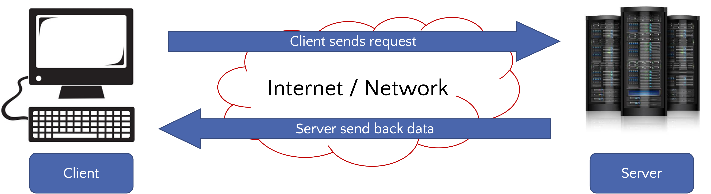

## Examples of Servers

| Server | What it does |
|--------|--------------|
| **File server** | Stores and distributes files. |
| **Print server** | Manages and distributes printing. |
| **Hypervisor server** | Hosts virtual machine guest operating systems for remote or shared access. |
| **Application server** | Runs applications shared by a large number of users. Clients don't need enough resources to run the applications, and don't have to maintain them. |
| **Mail server** | Transfers and stores mail over corporate networks and across the Internet. |
| **Web server** | Hosts web pages and makes them available across a network to the user's web browser. |

# Server Hardware

## Servers vs. Workstations

- **Servers** perform one or more **services** for the clients connected to them. They may provide access to shared files, printers and other network resources, or provide email and web hosting.
- **Workstations** are **personal computers**. They are used for applications such as word processing, graphic design, development and web browsing.

## Server Hardware Components

In many ways, server hardware isn't that different from workstation hardware. Servers use the same basic components:

- CPUs
- Main memory
- Secondary storage
- Power supplies

However, servers are:

- **Noisy**
- **Power hungry**
- In need of **good Internet access**
- In need of **increased security**

That is why servers are usually kept in dedicated **server centers** (or **data centers**).

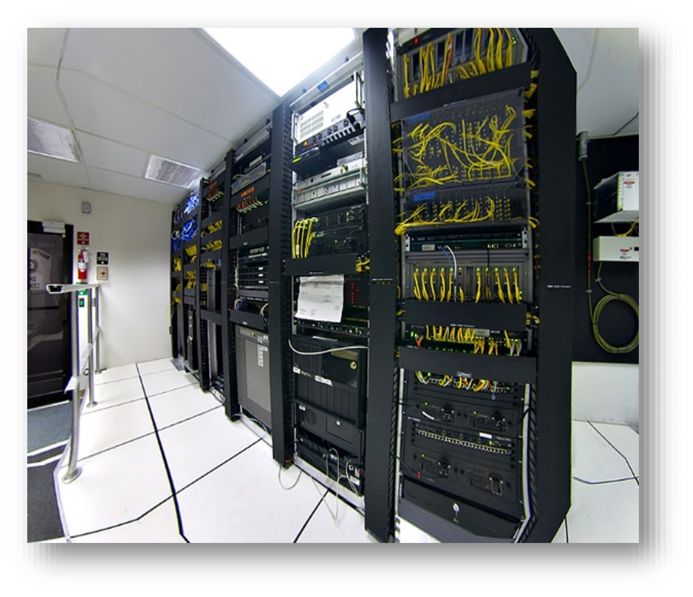

## Types of Servers (Form Factors)

There are three main server form factors: **tower**, **rack** and **blade**.

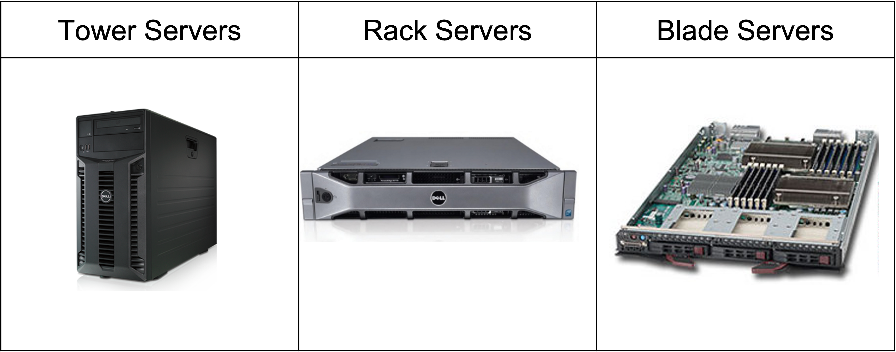

### Tower Servers

- Look like PCs.
- Each tower server is a **standalone** machine.
- Take up space and tend to be noisy.
- Usually used in **small** data centers.

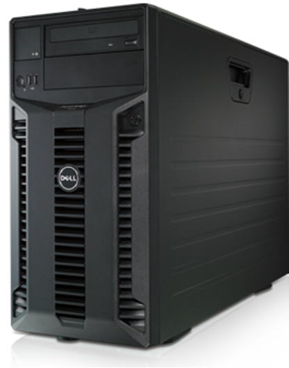

### Rack Servers

- Servers **mounted in a rack**, fixed with screws.
- Uniform width, various heights.
- Server height is measured in **rack units (U)**. A standard rack-mount server is a **1U** server, meaning it is 1 rack unit tall.
- Each rack holds **multiple servers**, typically stacked one on top of the other.

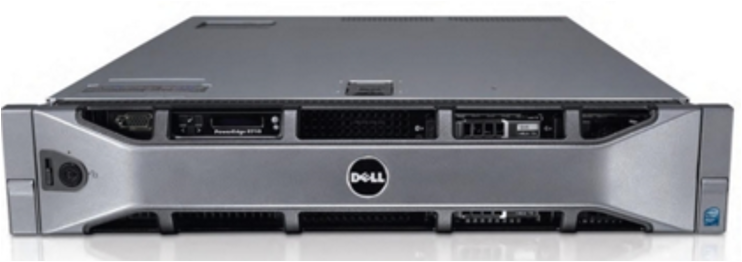

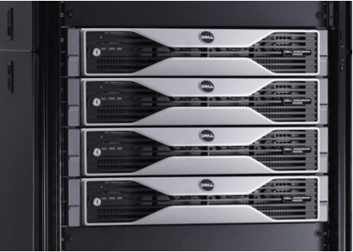

### Blade Servers

- Mount inside a special rack called a **chassis**.
- Tend to be **vendor proprietary**. For example, you can't insert a Dell blade server into an HP chassis.
- Lack certain components that rack servers have, such as power supplies. Instead, the **chassis** provides the power supply, cooling, etc.

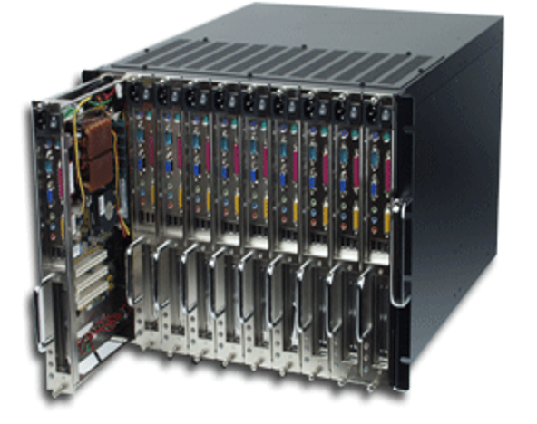

## Server Models

Not every network organizes its computers the same way. The **network model** describes who provides the services and who uses them.

### Centralized client-server

In the **client-server** model, one central server provides a service, and many clients connect to it to use that service. The clients never talk to each other directly: every request goes through the server.

- **Advantages:** data is stored in one place, so it is easier to **back up**, **secure** and **manage**.
- **Disadvantage:** the server is a **single point of failure**. If it goes down, none of the clients can use the service. This is why fault tolerance matters so much for servers (see [Fault Tolerance](#fault-tolerance)).

*Example:* when you log in to your John Abbott account or open a website, your computer is the client and the college's or website's server answers your request.

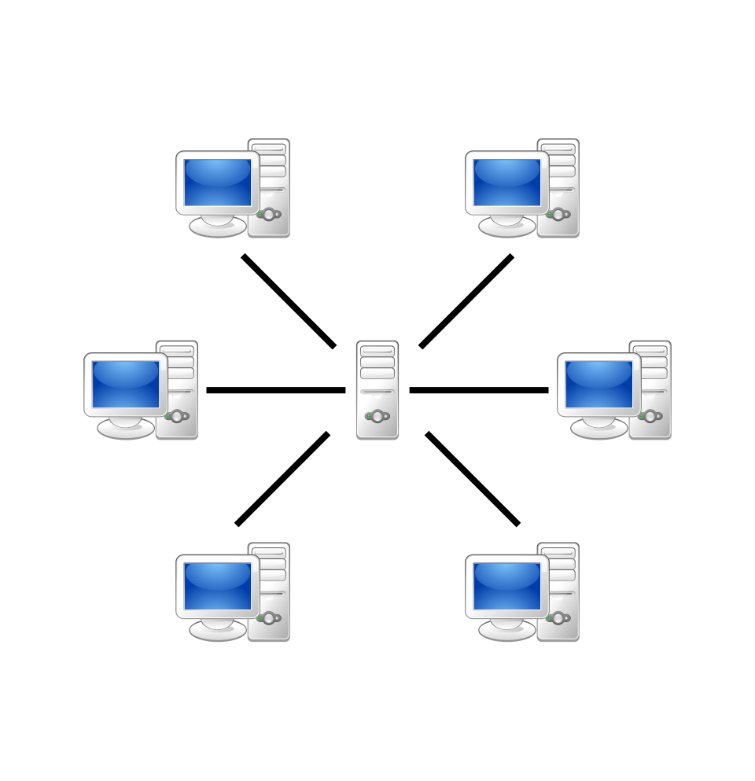

### Dedicated servers by role

In larger networks, each service usually runs on its own **dedicated server**. For example, a **file server** stores the shared files, and a **print server** manages the shared printers and their print jobs. All of these servers sit on the same network (e.g. Ethernet) as the clients.

Splitting services across servers means:

- Each server can use hardware suited to its job (lots of storage for a file server, for example).
- If one server fails, the other services keep working.

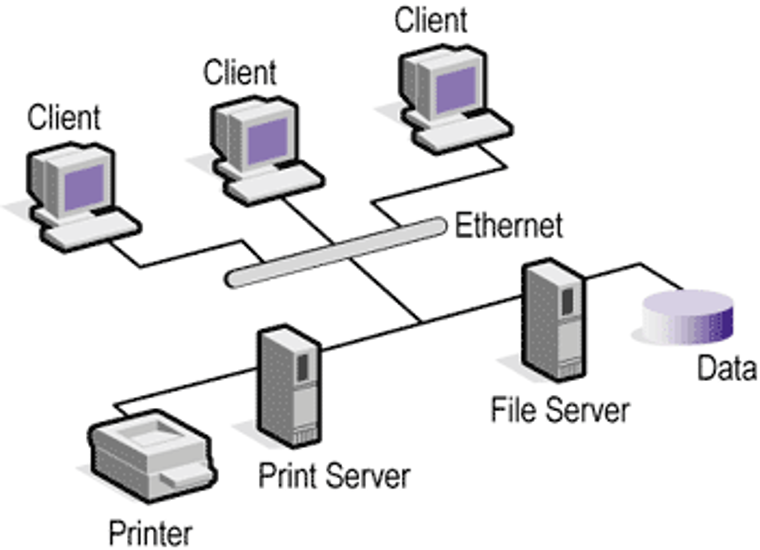

### Peer-to-peer (no server)

For comparison, in a **peer-to-peer (P2P)** network there is no dedicated server. Every computer (a **peer**) can act as both a **client** and a **server**. For example, one PC can share a printer that is plugged into it by USB, so the other PCs can print to it, but only while that PC is turned on.

- **Advantages:** cheap and simple to set up, since there is no server to buy.
- **Disadvantages:** weaker security, no central backup, and it doesn't scale well. It is best suited to small networks (about 10 computers or fewer).

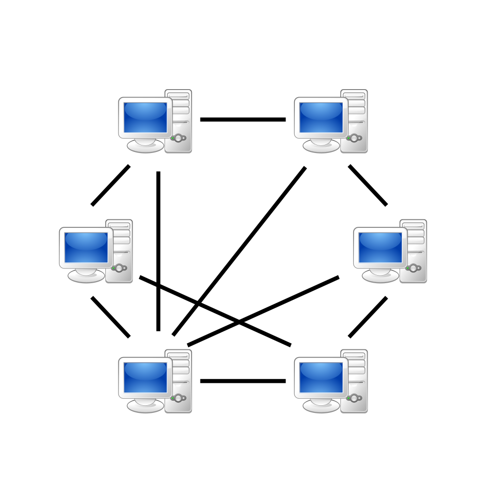

### Example: online game servers

Multiplayer games show these models in action. There are three common ways to host a match:

| Model | Who hosts the match? | Pros | Cons |
|-------|----------------------|------|------|
| **Dedicated server** | A server in a data center with no player on it | Fair and stable for everyone. The standard for competitive games | Expensive for the game company to run |
| **Listen server** | One player's computer, while that player also plays | Free for the company | The host's computer and Internet connection affect everyone. If the host leaves, the match can end |
| **Peer-to-peer** | Nobody: every player connects directly to the others | Cheap, low latency in small groups | Easier to cheat, and doesn't scale to large matches |

## Server Hardware vs. Computer Hardware

- In the hardware sense, a **server** is hardware intended to host software applications under **intense demand**.
- Most PCs can act as a server, but a dedicated server has features that make it better suited to production environments, where **performance** and **resilience** are important.
- Server hardware components are much **more expensive**.
- There is a **trade-off** between performance and cost.

## Server Hardware Performance Features

- **Advanced CPUs**
    - More cores
    - Extra cache
    - Hyperthreading
- **Server hard drives**
    - Resistant to vibrations
    - Large in size
    - Fast access time

# Fault Tolerance

**Fault tolerance** (or **redundancy**) is the property that lets a system keep **operating properly** when one or more of its components **fail**. Fault tolerance is crucial in server environments.

There are many fault tolerance mechanisms:

- Redundant files, volumes or drives
- Redundant hardware components or servers
- Hardware components with recovery options

## Examples of Fault Tolerance

### Power: RPS and UPS

- **Redundant power supply (RPS)**: uses more than one power supply, so there is a backup if one fails.
- **Uninterruptible power supply (UPS)**: a kind of power bar that contains a **battery**. During a power outage or brown-out, it lets low-power operations keep running and high-power operations shut down gracefully.

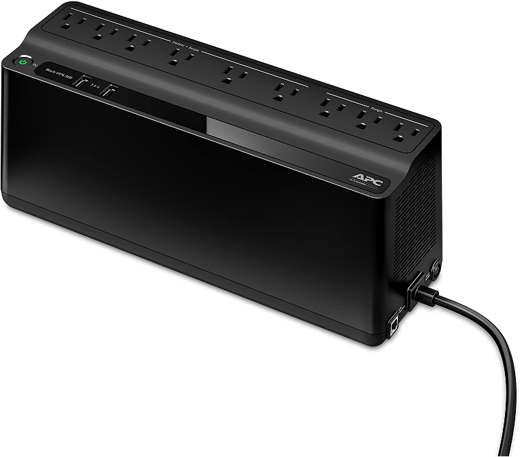

### Network: Redundant Network Interface Cards

- Attaching **extra NICs** (network interface cards) to a server duplicates its network connections, so they can run in parallel.
- This **improves performance** (combined speed) and provides **fault tolerance**.

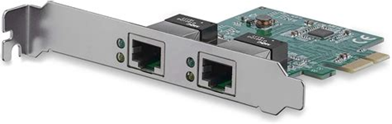

### Memory: ECC Memory

- **ECC** (error-correcting code) RAM automatically uses **parity** (like in Assignment 1) to detect and correct the most common kinds of internal data corruption.
- ECC RAM contains an **extra chip** to store the parity information.
- **Note:** not all motherboards support ECC RAM. Consumer-grade motherboards often skip "non-essential" features like this, which is controversial!

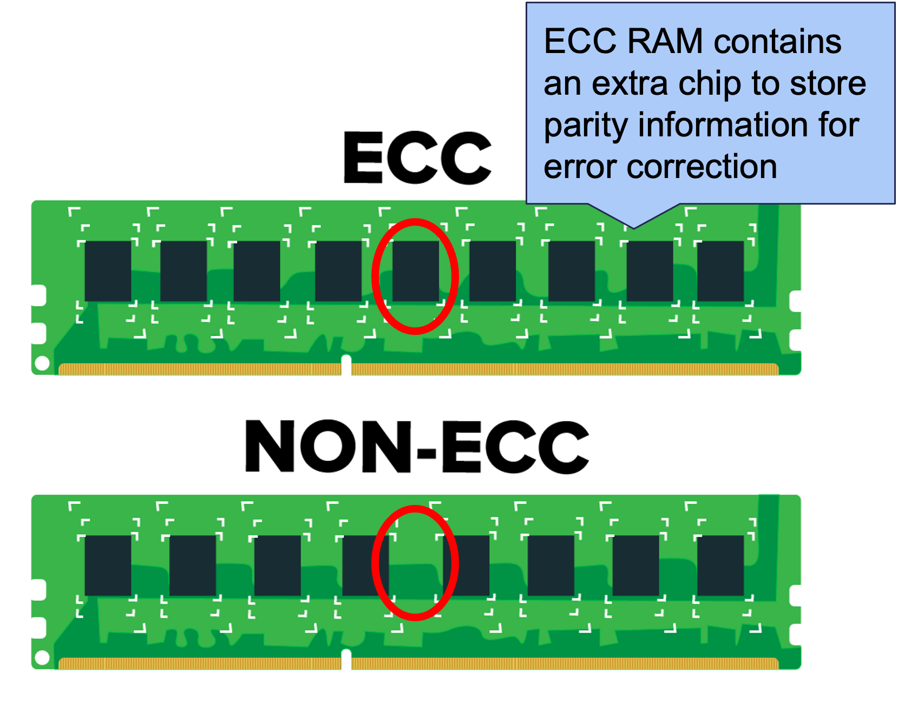

### Storage: RAID

- **RAID** (Redundant Array of Independent Disks) configures a group of storage disks to **stripe**, **mirror**, and/or apply **parity** to the data they store.
- Each of these either **improves performance** or **provides fault tolerance**.
- The sections below explain the possible RAID configurations.

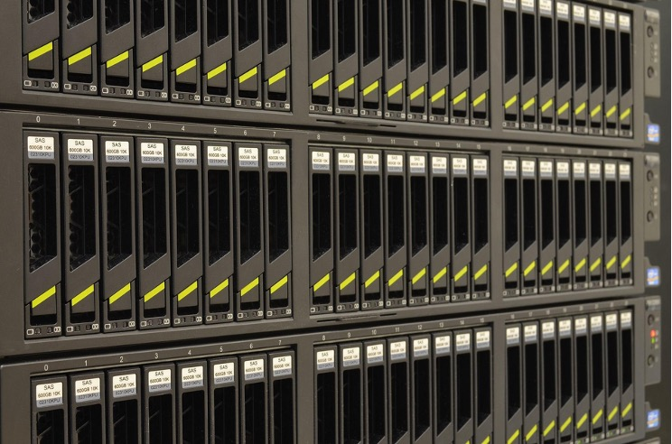

# RAID Configurations

::: {.callout-note}
In the disk diagrams below, each letter is a different **file block** (A is one file block, B is another, etc.).
:::

A handy tool for visualizing RAID storage capacity: [Seagate RAID calculator](https://www.seagate.com/ca/en/internal-hard-drives/raid-calculator/){target="_blank"}.

## Not RAID: JBOD ("Just a Bunch of Disks")

What's the simplest way to combine storage drives? **JBOD**: Just a Bunch of Disks.

- Data is **spanned** across all available disks.
- Nothing special is done to read or write data: wherever there is space on a disk, data can be written.
- **No fault tolerance** (no parity bits or mirroring).
- This is the simplest way to combine the storage of many disks so they appear as **one volume**.

**Combined storage:** each disk can be any size. The total storage is simply the sum of the disks (e.g. 1 TB + 2 TB + 3 TB = 6 TB).

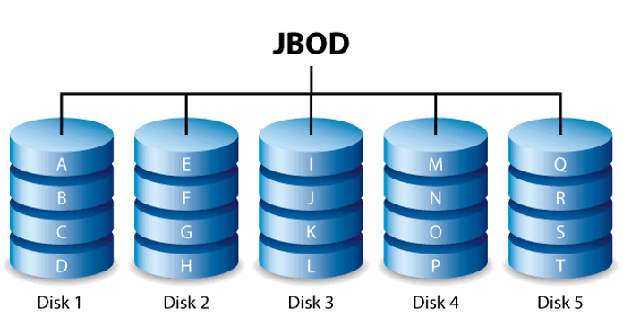

## RAID 0: Striping for Performance

RAID 0 is similar to JBOD, with one key difference: data is **striped** across all available disks. When new data is written, it is cut into blocks and spread across **all** the disks in the RAID configuration, so every file is written to every disk. (In the diagram, A is one file, and A1, A2, A3, etc. are the blocks containing file A's data.)

- **No fault tolerance** (no parity bits or mirroring).
- On HDDs, **better read/write speed** than one huge disk, because there are more access points to the data.

**Combined storage:** total capacity = **number of disks × size of the smallest disk**

Why? Data is striped across all disks, so once the smallest disk is full, no more data can be added. In RAID, it is very common to use disks of the **same size** to avoid wasting space.

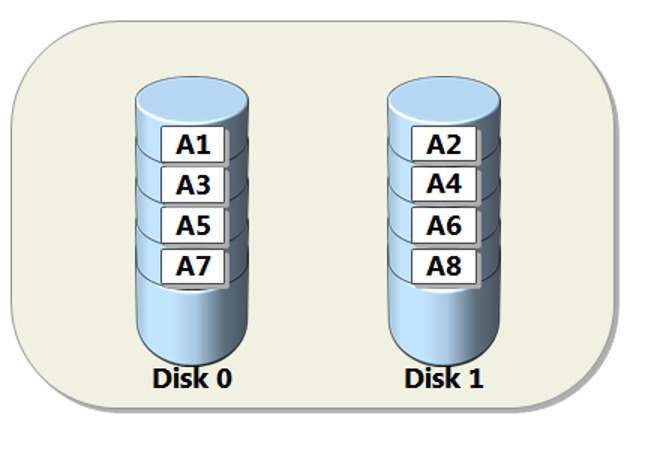

## RAID 1: Mirroring for Fault Tolerance

- **Disk mirroring**: data is **copied** onto more than one drive at the same time.
    - It is **not** striped, it is copied: file A is divided into four parts, and all four parts are on both disks.
- The **simplest and cheapest** way to implement fault tolerance.
- Requires a **minimum of 2 disks**. Each additional disk becomes another mirror: it adds protection, but **not storage**.
- RAID 1 is almost always used with exactly two disks.

**Combined storage:** total capacity = **size of the smallest disk**

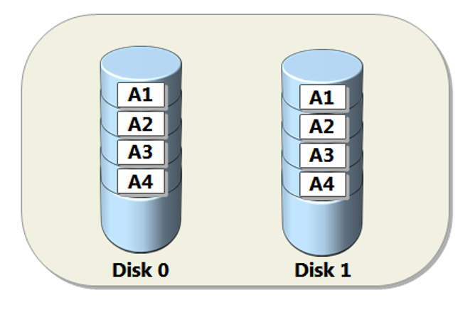

## RAID 5: Striping + 1 Disk of Parity

- A common RAID configuration for **business servers**.
- Data and **parity** (extra data used for recovery) are striped across **3 or more disks**. The equivalent of **1 disk** of storage is used for parity.
- If **any one disk fails**, its data can be re-created automatically from the parity on the remaining disks. If **more than one** disk fails, the data is lost permanently.
- A great solution for fault tolerance, but it **slows down** server performance.

**Combined storage:** total capacity = **(number of disks − 1) × size of the smallest disk**

Why? One disk's worth of space is used for parity; the rest is used for storage.

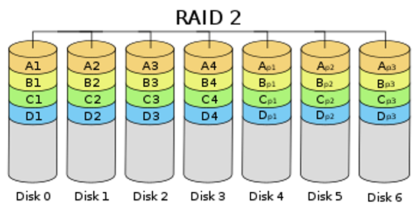

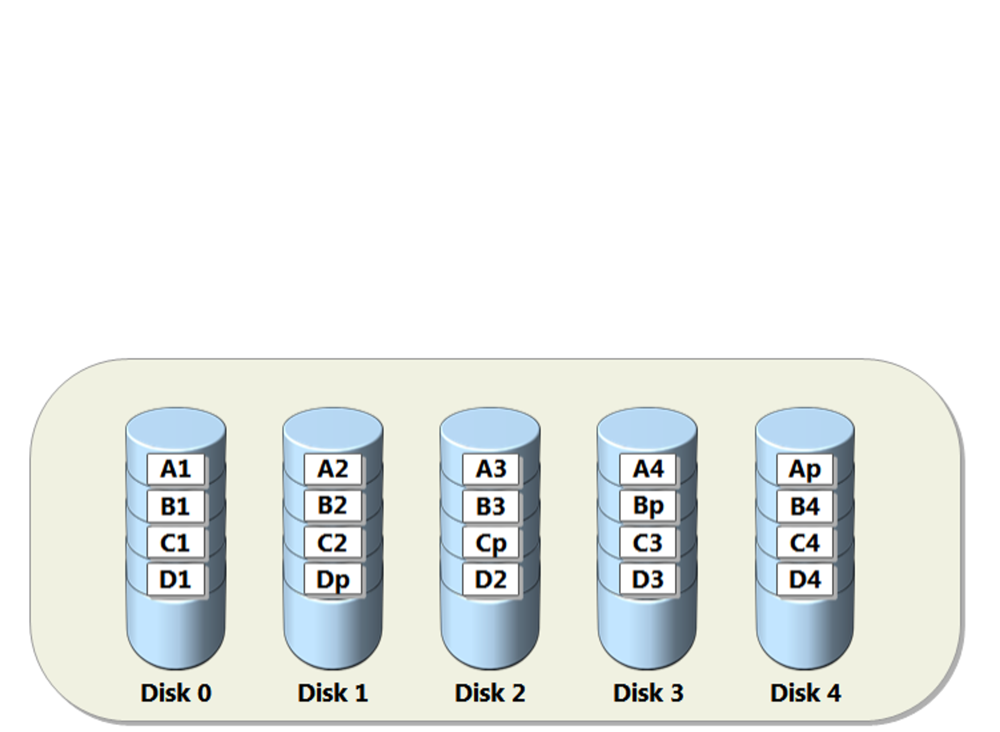

## RAID 6: Striping + 2 Disks of Parity

- Identical to RAID 5, but uses **one more parity block**.
- **More robust**: two disks can fail.
- **Less storage**: total capacity = **(number of disks − 2) × size of the smallest disk**

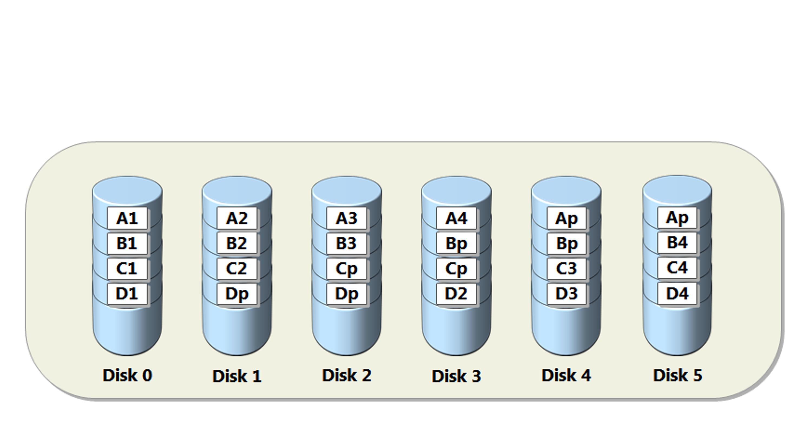

## RAID 10 (1+0): Striping + Mirroring

- Combines RAID 0 and RAID 1: the **mirroring** of RAID 1 with the **striping** of RAID 0.
- Gives the **best performance**, but requires **twice as many disks** (minimum of 4).

**Combined storage:** total capacity = **(number of disks × size of the smallest disk) ÷ 2**

Why? Half of the disks are used to mirror the data.

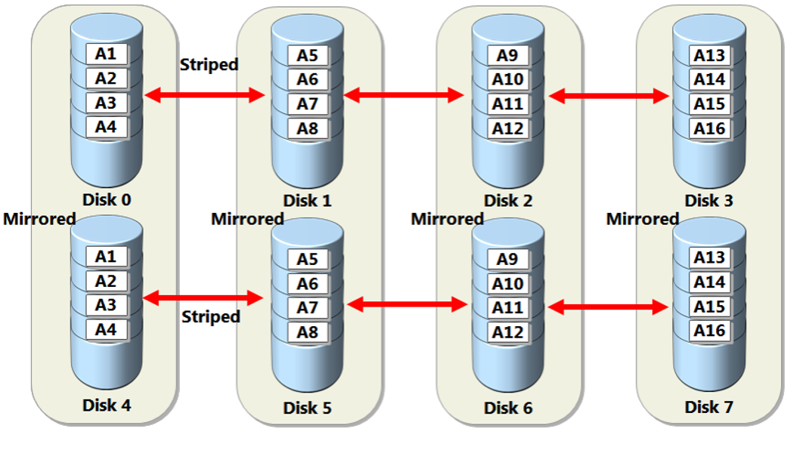

## RAID Summary

| Configuration | Technique | Minimum disks | Fault tolerance | Total capacity |
|---------------|-----------|---------------|-----------------|----------------|
| JBOD | Spanning | 1 | None | Sum of all disks |
| RAID 0 | Striping | 2 | None | Number of disks × smallest disk |
| RAID 1 | Mirroring | 2 | All but one disk can fail | Smallest disk |
| RAID 5 | Striping + 1 parity | 3 | 1 disk can fail | (Number of disks − 1) × smallest disk |
| RAID 6 | Striping + 2 parity | 4 | 2 disks can fail | (Number of disks − 2) × smallest disk |
| RAID 10 | Striping + mirroring | 4 | 1 disk per mirrored pair | (Number of disks × smallest disk) ÷ 2 |

# Technical Terms

## Spanning

- **Disk spanning** combines multiple storage disks into **one volume**.
- JBOD is an example of disk spanning: when one disk is full, the next disk is used.
- Spanning adds **no extra efficiency or fault tolerance**. It simply lets you combine disks to create larger storage volumes.

## Striping

- **Disk striping** divides data into blocks and spreads the blocks across **multiple** storage devices.
- Each file is therefore stored on **all** of the striped disks. This is very different from spanning!
- Different storage systems stripe in different ways (e.g. at the byte or block level).
- Striping provides **high performance** (faster reads and writes) but **low resiliency**: if any physical drive fails, data is lost.

## Mirroring

- **Mirroring** writes the **same data** to more than one disk.
- It is a good choice for applications that need high performance and high availability, such as transactional applications.
- Data can be read from both disks at the same time, so **reads are fast**. However, **writes are slower**, because they have to be done twice.

See also: [Volume Types](disk-partitions.qmd#volume-types) on dynamic disks in Windows.

# Clusters

- A **cluster** is a combination of **multiple computers or servers** whose purpose is to give users access to **large amounts of CPU and GPU** power.
- Clusters are often made up of sets of computers or supercomputers, each called a **node**.
- Each node performs the **same task**, and the nodes are controlled and managed by software called a **scheduler**.

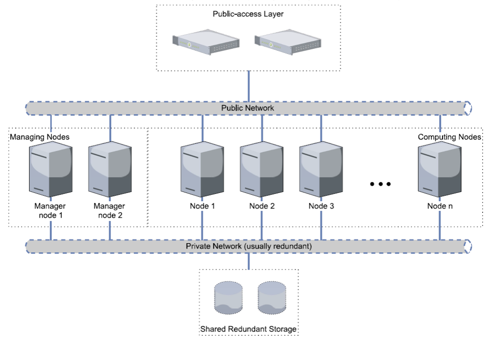

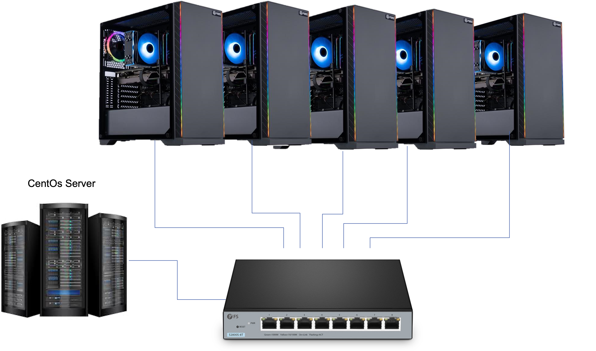

## Where Are Clusters Used?

Clusters are used wherever a problem needs more computing power than a single machine can provide:

- **Scientific research**: weather forecasting, climate modelling, physics and chemistry simulations.
- **Medicine and biology**: genome sequencing, protein folding, drug discovery.
- **Artificial intelligence**: training machine learning models on large numbers of GPUs.
- **Engineering**: simulating car crashes, airflow over aircraft wings, or structural loads on buildings.
- **Film and animation**: rendering visual effects and animated movies (called a **render farm**).
- **Finance**: risk analysis, fraud detection and high-speed trading calculations.
- **Web services**: large websites and online games spread traffic across many servers to handle millions of users.
