Adapted from the original [slides](./permissions_users_registries.pdf){target="_blank"} with the help of Claude AI for restructuring.

::: {.callout-tip icon="false" title="☆Learning Objectives"}

Upon completing this lesson, you should be able to: 

- **Recognize** the NTFS file permissions
- **Share** a folder on the network 
- **Differentiate** a Standard user and an Administrator on Windows
- **Add** standard and administrator users to Windows machine. 
- **Describe** what is a local profile
- **Differentiate** between a local, roaming, temporary and mandatory user profile.
- **Describe** what are registries
- **Add** and **Modify** a registry key to customize Windows.
- **Install** applications for a given user profile or for all users
:::

# File Permissions

## File properties

The **Properties** tab of files and folders in Windows lets you configure permissions for different users or groups of users.

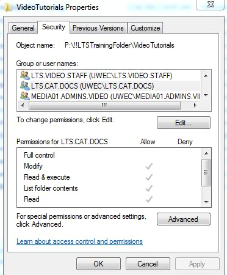{width=350px}

## NTFS permissions

Click **Edit** to change permissions. These are the NTFS permissions:

| Permission | What it allows |
|---|---|
| Full Control | Everything |
| Modify | Everything except taking ownership |
| Read and Execute | View files and run apps |
| List Folder Contents | View folders, but not access files |
| Read | Open and view files |
| Write | Create folders and files, and edit them |

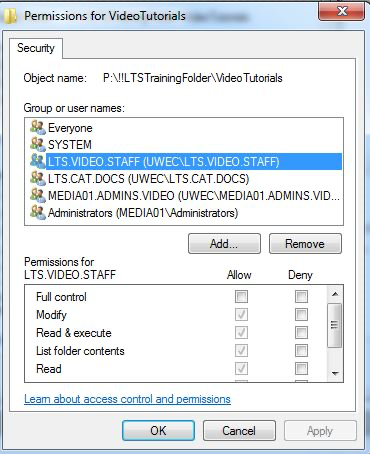{width=350px}

## Adding a user

- Click the **Edit** button; this opens a new window.
- Click **Add**, then type the name of the user (e.g. `FrenchUser`), or click **Advanced → Add** to find the user.

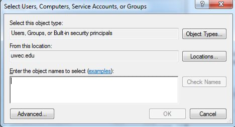{width=450px}


# User Profiles

## What is a user profile?

- A user profile is created the first time a user logs into a computer.
- On later logins, the system loads the user's profile and configures the computer environment according to the information stored in it.

{width=550px}

## Adding another user on Windows 11

Since Windows 8, Microsoft has favoured Microsoft Cloud accounts over creating local accounts (only existing on the PC). Cloud accounts require a login using an email and password from a valid Microsoft platform such as Outlook.com, Live.com, Hotmail.com or a school/work Microfot 365 account. 
Altough most editions of Windows 11, push for using a cloud account when first installing Windows (OOBE screen, forcing a login), it's still possible to create local account:

Officially, there are two ways to add a user in Windows 11: **with** a Microsoft account or **without** one.

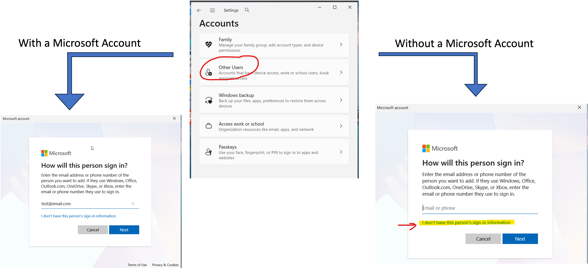{width=500px}

> Source: [How to Create a Local or Offline Account in Windows 11 or Windows 10](https://learn.microsoft.com/en-us/answers/questions/4377514/article-how-to-create-a-local-or-offline-account-i)

### User account with a Microsoft account

- Uses features such as synchronization across devices.
- Gives access to Microsoft services such as Office 365, OneDrive, etc.
- Requires Internet access.

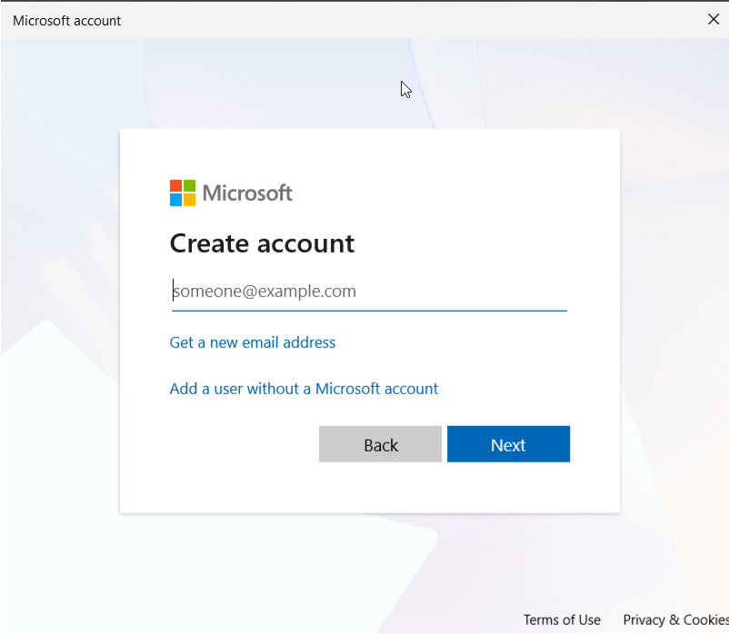{width=450px}

### Local user account (without a Microsoft account)

- Creates a user account only on this particular machine.
- All Windows machines have a built-in local administrator account used for troubleshooting.
- This can also be done via **Computer Management** (`Win + R`, type `compmgmt.msc`).
- Or via the command prompt:

```cmd
net user <username> <password> /add
```

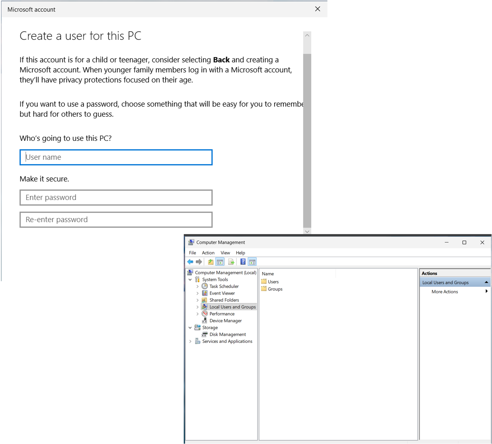{width=550px}

::: {.callout-tip}
## Activity on VM: Adding local user profiles

1. **Start → Control Panel**
2. **User Accounts → Manage another account**
3. Add a user account: **French User**
   - Using a Microsoft account
   - Without a Microsoft account
4. Add a second user account: **Big Boss**
   - Without a Microsoft account
5. Select the newly created account and change the account type to **Local Administrator**.
:::

::: {.callout-tip}
## Using the Command Line Terminal: Adding local user profiles
1. Run CMD with admin permissions
2. Type the command above to add a third user.
:::

## User account types

| Administrator | Standard |
|---|---|
| Administrators are "super users" with full control of a computer. They can install or modify software and access any file. | Have partial control over a computer. For example, they can only install apps and software within their local user directory. |
| They can add other users and change their user types. | They cannot install system-wide applications or access other users' files. |

## Administrator account required

::: {layout-ncol=2}
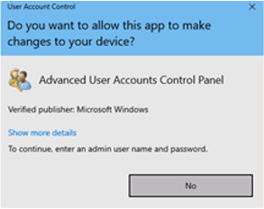

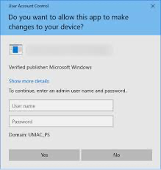
:::

## What is a user profile made up of?

**User profile** = **Registry hive** (`HKEY_CURRENT_USER`) **+** **a set of folders** stored in the file system

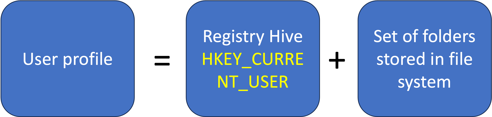{width=550px fig-alt="User profile equals the registry hive HKEY_CURRENT_USER (NTUSER) plus a set of folders stored in the file system"}

## Types of user profiles

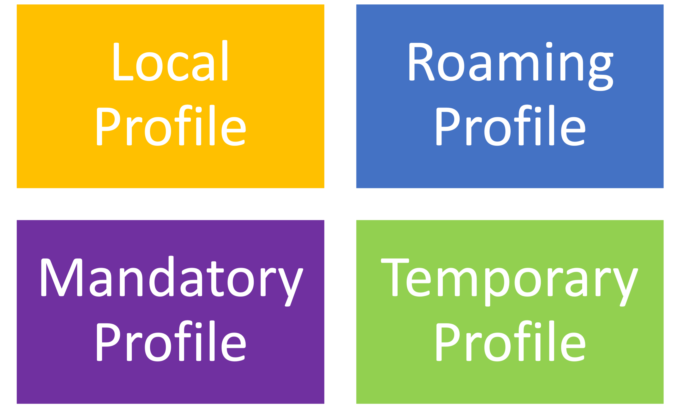{width=400px fig-alt="The four types of user profiles: local, roaming, mandatory and temporary"}

| Profile | Description |
|---|---|
| **Local** | Localized to this specific machine. |
| **Roaming** | Downloads the settings from the main server onto any PC logged into within the network. *Example: your John Abbott school account.* |
| **Mandatory** | Administrators can create mandatory user profiles with settings for users. |
| **Temporary** | Created if an error prevents the user profile from loading. Deleted automatically at the end of each session. *Example: an account at a computer in a public library.* |

# Registries

## What is the registry?

The Windows registry is a hierarchical database that stores configuration settings and options for the Microsoft Windows operating system and installed applications.

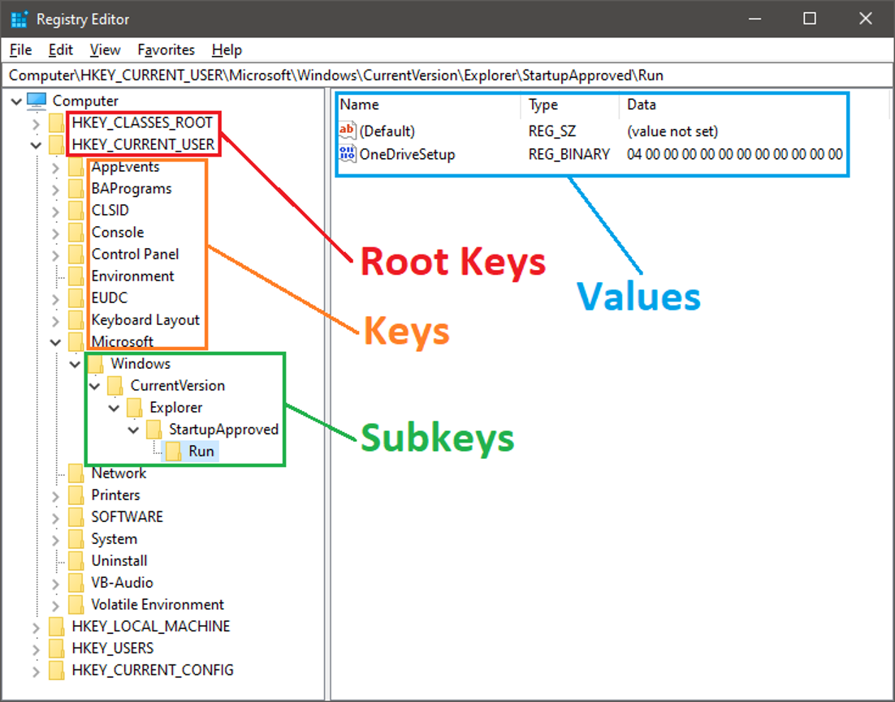{width=550px}

## Windows Registry

Computer technicians should:

- Understand basic Registry components,
- Know how to edit the Registry manually,
- Know the best way to locate a particular setting.

## Accessing the Registry

- To access the Registry, type `regedit` in the **Start** (⊞ Win) search bar.
- The Registry is organized in a tree structure, similar to folders in a file system.
- It shows keys (or subkeys) on the left and values on the right.

## Five main root keys

| Root key | Description |
|---|---|
| `HKEY_CLASSES_ROOT` | Historically defined the standard class objects used by Windows. Now provides backwards compatibility for older applications. |
| `HKEY_CURRENT_USER`, `HKEY_USERS` | Store personalized information for each user with an account on the system, such as desktop colours, screensavers and desktop contents. |
| `HKEY_LOCAL_MACHINE` | Contains all the data for the system's non-user-specific configuration. This covers every device and every program on your computer. |
| `HKEY_CURRENT_CONFIG` | If values in `HKEY_LOCAL_MACHINE` have more than one option (e.g. two different monitors), this root key defines which one is currently being used. |

## Using Registry Editor

::: {.callout-warning}
- When you use the Registry Editor, you risk breaking things.
- Applications might not start, utilities may not work, or your computer may not boot.
- **Always back up the Registry** (preferably to a thumb drive) before you change anything. After making the change, reboot to see if it had the desired effect. If not, restore the old settings from your backup.
:::

::: {.callout-tip}
## Activity VM: Backing up and restoring the Registry

- **To save a copy of the Registry:** export the full registry, or a single key or subkey (with all subkeys and values under it), using **File → Export**.
- The backup is saved with the extension `.reg`.
- **To restore backed-up keys:** use **File → Import**, or right-click the `.reg` file and select **Merge**.
:::

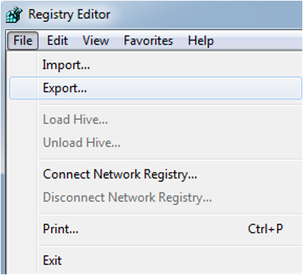{width=350px}

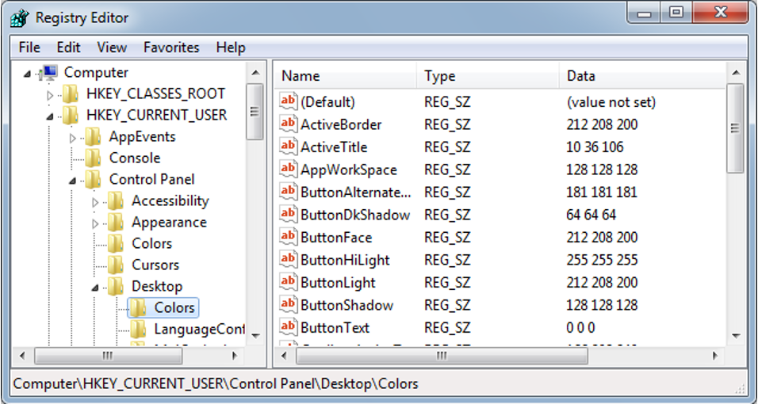{width=550px}

::: {.callout-tip}
## Activity VM: Change the highlight colour

1. Press **Windows key + R** to open the Run dialog box.
2. Type `regedit` and press **Enter** to open the Registry Editor.
3. Navigate to `HKEY_CURRENT_USER\Control Panel\Colors`.
4. Find the **Hilight** value in the right-hand pane. It controls the highlight colour of selected items.
5. Double-click **Hilight** to open its properties.
6. In the **Value data** field, enter the RGB value of the colour you want. For example, for light blue enter `192 217 255`.
7. Click **OK** to save the changes.
8. Close the Registry Editor.

More registry hacks: <https://www.minitool.com/backup-tips/windows-10-registry-hacks.html>
:::

# Other OS Maintenance Tasks 

### Updates to the OS and applications

- A **service pack** is a collection of updates, fixes or enhancements to a software program, delivered as a single installable package. It may add new OS features as well as bug fixes, security enhancements, etc.
- Service packs are commonly issued within the first two years after a product's release, and are usually numbered (e.g. SP1, SP2).
- **Note:** Microsoft recommends never being more than two service packs behind.

# Q&A
